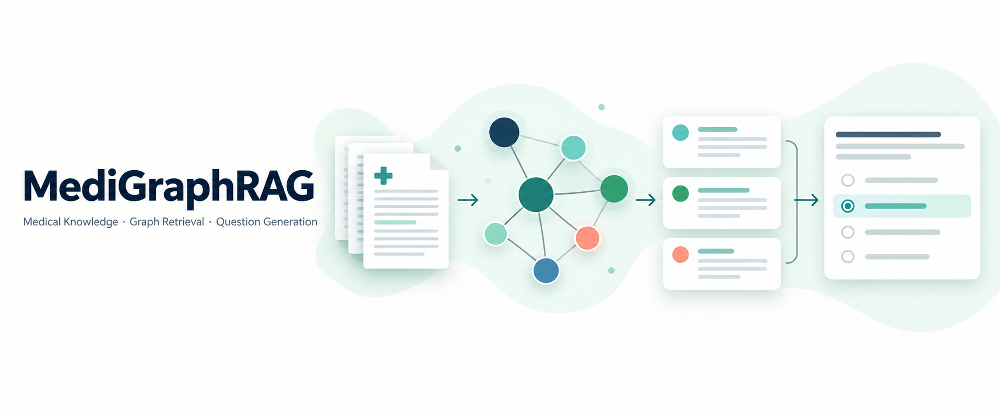
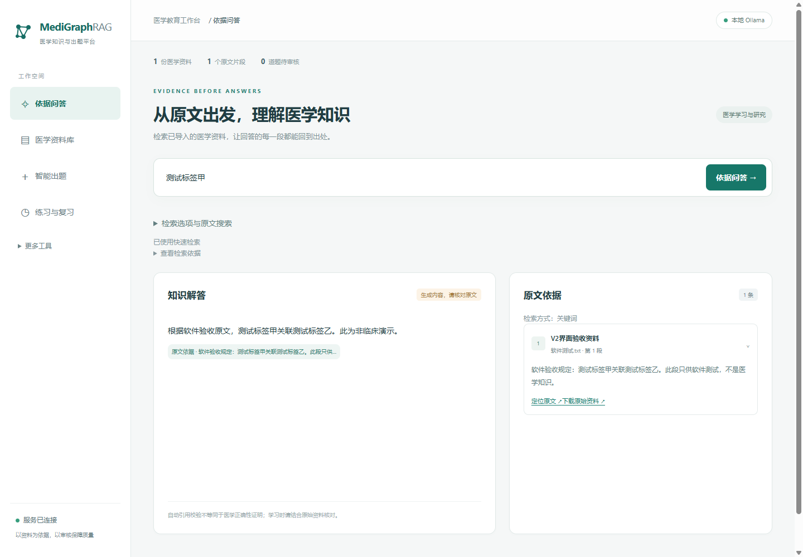
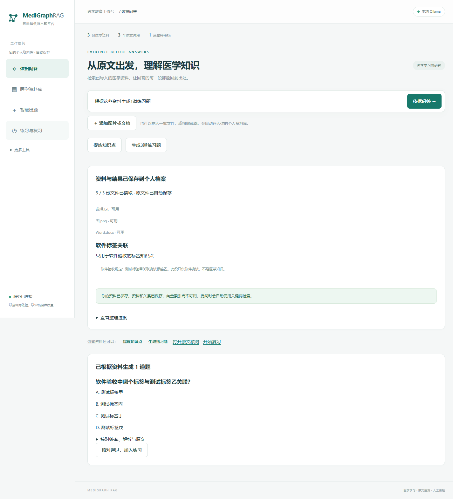
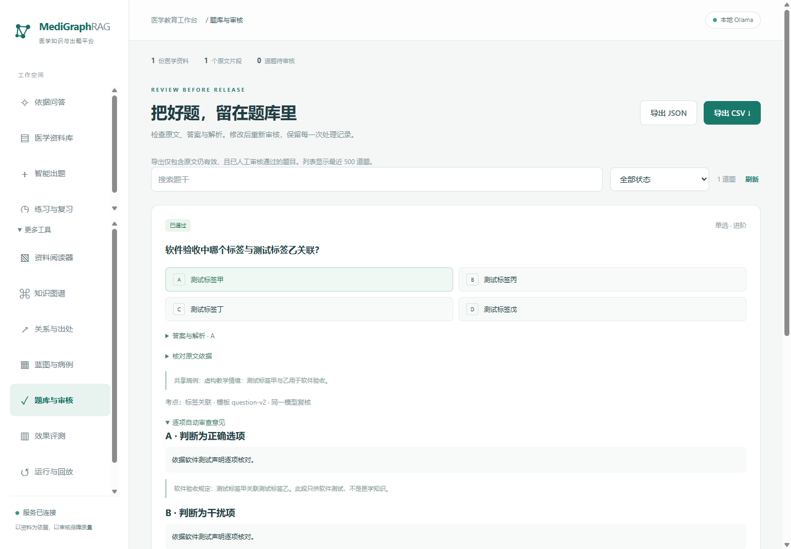
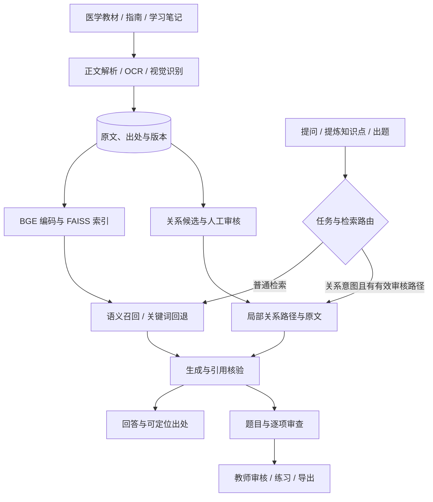
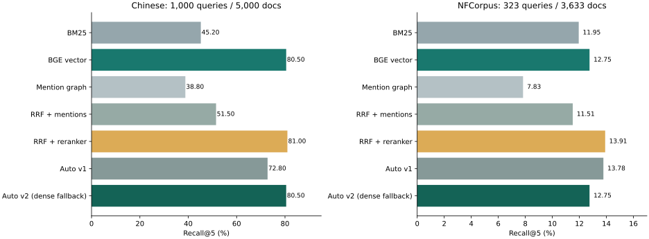

<div align="center">

# MediGraphRAG

**医学知识图谱增强检索与试题生成**

从医学资料到原文依据，从知识理解到教学练习。

Python · FastAPI · Vue 3 · BGE · FAISS · Ollama

[](https://github.com/hvqo/MediGraphRAG/actions/workflows/checks.yml)   

[功能特性](#功能特性) · [界面预览](#界面预览) · [系统架构](#系统架构) · [快速开始](#快速开始) · [配置说明](#配置说明) · [效果评测](#效果评测) · [项目结构](#项目结构)

</div>



MediGraphRAG 面向医学教育与研究，将教材、指南和学习笔记整理为可检索、可回看的知识依据。
用户可以直接提问，也可以上传一批图片、PDF 或 Word，要求提炼知识点、生成练习题。
系统完成资料识别、检索、生成与引用校验，并将文件和处理结果保存到个人资料库。

> 本页介绍 **0.6.0 改造版**，代码位于 `refactor/medigraphrag`。
> 原始版本的 README 保留在 [main 分支](https://github.com/hvqo/MediGraphRAG/blob/main/README.md)，原始代码可从[备份分支](https://github.com/hvqo/MediGraphRAG/tree/backup/main-before-refactor-20261027)查看。

## 功能特性

| | 能力 | 说明 |
| :---: | --- | --- |
| 📚 | **医学资料库** | 批量导入 PDF、DOCX、图片、TXT 和 Markdown，保留原文件、页码或段落位置，自动去重与归档。 |
| 🔎 | **带依据问答** | 输入问题后自动检索，回答附逐字引文，可回到原文核对；关系问题按需补充审核路径。 |
| 🧩 | **知识关联与图谱** | 浏览原文提及和概念关联，提取带出处的医学关系候选，审核后用于局部路径检索。 |
| ✍️ | **智能出题** | 从资料中的知识点生成单选、多选或病例题，提供答案、解析和逐项审查意见。 |
| ✅ | **题库与教学** | 教师审核、编辑重审、蓝图组卷、共享病例、JSON/CSV 导出及练习复习。 |
| 🗂️ | **个人档案** | 保存资料、题目与任务进度，后台建立向量索引和提及关系，后续问答复用已上传内容。 |

## 界面预览

### 直接提问，连同出处一起理解

输入医学问题即可开始。常用入口集中在问答、资料、出题和复习，检索策略由后台选择。
回答与原文并排呈现，点击引文可进一步定位资料。



### 上传资料，用一句话完成处理

拖入文件或粘贴截图，说出“提炼这些资料的知识点”“生成五道基础多选题”等要求。
题目与处理结果在同页展示，文件自动归档；向量索引与资料关联在后台继续整理。


<details>
<summary>查看：批量上传图片、Word 与文本后生成练习题</summary>



</details>

### 从生成题目，到可审核的题库

题目保留答案、解析与原文依据，审查意见逐项对应选项。
教师可核对、修改并审核，之后加入练习或导出；来源变化时，相关题目会标记为需要复核。



<sub>以上为真实浏览器中的功能演示截图，使用非临床验收资料和模型桩展示交互。医学模型与公开数据的实际测量见[效果评测](#效果评测)。</sub>

## 系统架构

系统围绕“资料 → 检索依据 → 问答与出题”组织。前端使用 Vue，后端使用 Python；
文档解析、检索、关系管理、生成、教学与评测分别实现为独立模块。



- **资料处理**：优先读取原生正文；文字图片尝试 CPU OCR，图示或不确定内容转本地视觉模型。原文件保留供核对。
- **检索与图谱**：有效索引就绪时优先语义召回，否则使用关键词；关系意图可查询最多两跳的审核关系路径。
- **生成与审查**：依据固定检索片段生成，检查引句，再进行模型复核；出题通过自动检查后进入人工待审。
- **存储与任务**：SQLite 保存原文、关系和任务，FAISS 保存向量；前台请求优先，后台分批补充索引与关联。

### 技术栈

| 层次 | 技术 | 对应实现 |
| --- | --- | --- |
| 前端 | Vue 3、Vue Router、Pinia、TypeScript、Vite | `frontend/src`；入口和新模块使用 TypeScript |
| 原文与图展示 | PDF.js、ECharts | PDF 页内高亮、原文阅读、概念关联展示 |
| 后端 | Python、FastAPI、Pydantic | `backend/app` |
| 多模态解析 | pypdf、DOCX XML、Pillow、pypdfium2、RapidOCR、Qwen2.5-VL | `documents.py`、`multimodal.py`、`ocr.py` |
| 检索 | BGE、FAISS、BM25、可选重排、审核关系路径 | `retrieval.py`、`ranking.py`、`routing.py` |
| 生成与教学 | Ollama / OpenAI 兼容接口、引用校验、独立审题 | `llm.py`、`evidence.py`、`questions.py` |
| 持久化 | SQLite、原文件、FAISS 索引、版本化迁移 | 每个本机浏览器档案独立保存 |
| 工程验证 | unittest、Ruff、vue-tsc、Playwright、GitHub Actions | `tests`、`scripts`、`.github` |

<details>
<summary>与原始 Neo4j / MetaGPT 实现的关系</summary>

原版已经采用 **BGE → FAISS 召回 → Neo4j 关联扩展 → 重排 → 知识清洗 Agent → 出题 Agent** 的流程。
改造版保留医学检索与出题方向，同时调整了索引对象、关系存储和任务组织，属于工程与架构改造。

| 部分 | 原始版本 | 当前改造版 |
| --- | --- | --- |
| 索引对象 | 图谱实体名称、知识点文本 | 带出处的文档片段 |
| 在线关系查询 | Neo4j 节点及邻接关系 | SQLite 中的审核关系路径；Neo4j 为可选同步适配 |
| 出题组织 | MetaGPT 双角色协作 | 生成、引用校验、独立审题与教师审核 |
| 历史实验 | Python 代码保存在 `.ipynb` 中 | 61 个代码单元迁入 `legacy/experiments`，保留来源校验清单 |

原始 Python 实现保存在 `legacy` 和 Git 备份分支中。
Notebook 整理记录见[源码布局](docs/SOURCE_LAYOUT.md)；当前评测尚未覆盖原版完整 Neo4j / MetaGPT 链路的同条件比较。

</details>

## 快速开始

### 1. 准备环境

| 组件 | 项目已验证配置 |
| --- | --- |
| Python | 3.10.10；建议使用独立虚拟环境 |
| Node.js | 24，前端使用 npm |
| 文字生成 | 本地 Ollama，或在设置中配置云端接口 |
| 图片与扫描页 | CPU OCR；图示识别使用本地 Ollama 视觉模型 |
| 语义检索 | 可选 PyTorch、完整 BGE 权重与 FAISS |

获取改造分支，并激活现有虚拟环境。首次使用可创建环境：

```bash
git clone --branch refactor/medigraphrag https://github.com/hvqo/MediGraphRAG.git
cd MediGraphRAG
python -m venv .venv
```

Windows PowerShell：`.\.venv\Scripts\Activate.ps1`；Linux / macOS：`source .venv/bin/activate`。
已有环境可直接激活，跳过创建步骤。

### 2. 安装与启动

```bash
python -m pip install -r requirements-ocr.txt
python -m pip install -e .

cd frontend
npm ci
npm run build
cd ..

python main.py
```

打开 **http://127.0.0.1:8000**，接口文档位于 **http://127.0.0.1:8000/docs**。

### 3. 配置模型，添加第一份资料

在“更多工具 → 模型与设置”中选择本地或云端文字模型。本地默认模型为 `qwen2.5`，
图示识别使用 `qwen2.5vl:7b`，可按需准备：

```bash
ollama pull qwen2.5
ollama pull qwen2.5vl:7b
```

返回问答页，添加资料并输入处理要求。普通文字解析与关键词检索可先行使用，
语义检索需要完整模型权重；上传任务会在后台自动建立可用索引。

<details>
<summary>可选：配置真实向量检索与评测资源</summary>

先安装与本机 CPU / CUDA 匹配的 PyTorch，再安装检索与评测依赖：

```bash
python -m pip install -r requirements-benchmark.txt
python scripts/prepare_medical_assets.py
```

准备脚本会下载固定版本的中英文 BGE、重排模型及公开评测数据，校验 SHA256，并复用已有缓存。
资源保存在被 Git 忽略的 `.runtime`；版本清单见 [assets-manifest.json](benchmarks/assets-manifest.json)。
该脚本同时准备评测数据，日常问答无需重复运行。

</details>

## 配置说明

| 配置项 | 入口与作用 |
| --- | --- |
| 本地文字模型 | 设置页填写 Ollama 地址与模型名称 |
| 云端文字模型 | 设置页填写兼容接口地址、模型 ID 与密钥 |
| 独立审题 | 可沿用生成模型，也可配置另一个审题模型 |
| 检索参数 | 设置页配置 Top K、运行设备及可选重排 |
| 嵌入 / 重排权重 | 默认识别 `.runtime/models`；可用 `MEDIGRAPH_EMBEDDING_PATH`、`MEDIGRAPH_RERANKER_PATH` 指定 |
| 存储位置 | 默认 `.runtime`；可用 `MEDIGRAPH_DATA_DIR` 指定 |

文件、原文、题库与任务保存在 `.runtime/libraries/<档案ID>`，模型及评测缓存同样位于 `.runtime` 下。
备份时应保留整个目录；服务默认绑定本机地址。

## 效果评测

已使用公开医学 / 生物医学数据和本机真实模型开展检索与答案对照，逐题结果可复现。

| 数据集 | 本轮实验范围 | 结果记录 |
| --- | --- | --- |
| 中文 MedicalRetrieval | 1,000 个查询，5,000 篇受控检索子集 | [逐题排名与指标](benchmarks/results/medicalretrieval-real.json) |
| NFCorpus | 完整测试集：323 个查询、3,633 篇文档 | [逐题排名与指标](benchmarks/results/nfcorpus-real.json) |
| PubMedQA | 1,000 篇摘要检索池，60 个均衡抽样问题，7 种方案 | [检索与答案对照](benchmarks/results/pubmedqa-real.json) |



中文子集中，向量 **Recall@5 为80.5%**，召回后重排为 **81.0%**；对应检索 P50 为17.40ms与126.52ms。
该计时来自 RTX4050 上的预热检索内核，不含 HTTP、冷启动及回答生成。中文结果为受控子集成绩。

PubMedQA 本轮60题的最高答案标签准确率为 **56.67%**。答案质量、多跳医学推理与自然文档识别仍需进一步验证。

**[查看完整评测报告](docs/MEDICAL_BENCHMARK.md)**：包含各方案 Precision、Recall、MRR、nDCG、P50/P95、答案判定、失败记录、实验条件和复现命令。

## 项目结构

```text
MediGraphRAG/
├── backend/app/          # Python API、检索、图谱、生成与教学
├── frontend/src/         # Vue 界面、路由与状态
├── legacy/               # 原版智能体、工具和 Notebook 迁出代码
├── benchmarks/           # 公开评测指标、资产版本与环境记录
├── docs/
│   ├── images/           # 当前界面截图与评测图
│   └── legacy/           # 原版文档与插图
├── tests/                # 后端功能测试
├── scripts/              # 资源准备、评测及浏览器验收
├── .runtime/             # 本机数据、模型与索引，不提交 Git
├── main.py               # 服务启动入口
└── pyproject.toml        # Python 包与命令行定义
```

## 使用说明

本项目用于医学教育与研究，生成答案和题目需要结合原始资料核对，并由专业人员审核。
当前个人档案采用本机浏览器身份隔离；关系查询使用 SQLite，Neo4j 同步适配尚未实连验收。
图片经 OCR 或视觉模型转为文本参与检索，独立图像向量检索尚未实现。
长文知识点提炼采用有限片段采样，完整处理范围见[个人工作台说明](docs/PERSONAL_WORKSPACE.md)。

<details>
<summary>开发检查与更多文档</summary>

```bash
python -m unittest discover -s tests -v
ruff check backend tests scripts main.py
python scripts/check_repository.py
python scripts/check_v2_ui.py --capture-docs
cd frontend
npm run format:check
npm run typecheck
npm run build
```

- [个人资料库与任务流程](docs/PERSONAL_WORKSPACE.md)
- [自动检索与图谱设计](docs/ADAPTIVE_RAG_DESIGN.md)
- [蓝图、病例、学习与版本管理](docs/V2_GUIDE.md)
- [源码整理与 Notebook 迁移](docs/SOURCE_LAYOUT.md)
- [阶段进度](docs/PROGRESS.md)

</details>

问题反馈与功能建议请提交至 [Issues](https://github.com/hvqo/MediGraphRAG/issues)。
