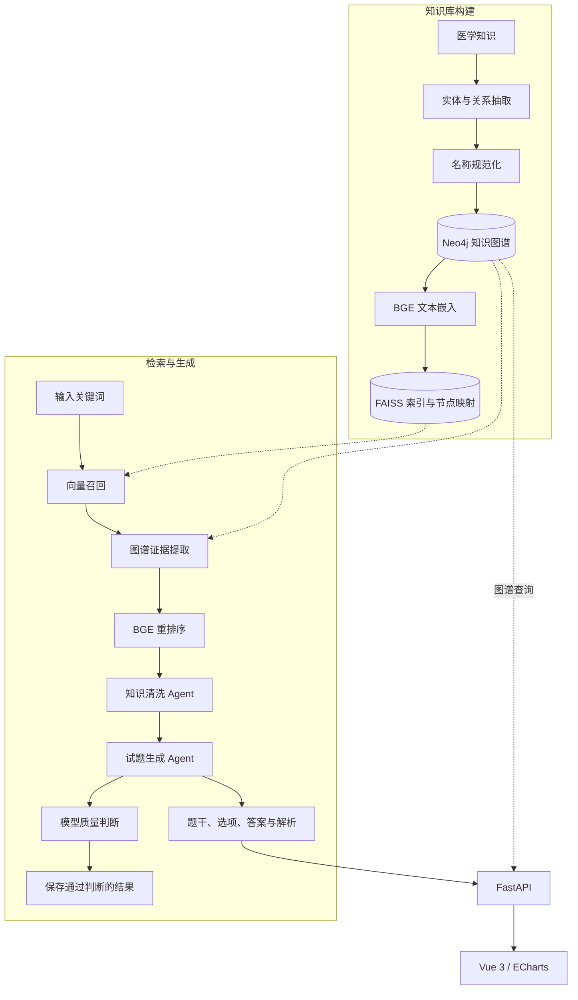

<div align="center">

# MediGraphRAG

**医学知识图谱增强检索与试题生成**

Neo4j · FAISS · BGE · MetaGPT · Vue 3

[功能特性](#功能特性) · [系统架构](#系统架构) · [快速开始](#快速开始) · [配置说明](#配置说明) · [API](#api) · [项目结构](#项目结构)

</div>


MediGraphRAG 是面向医学教育的 GraphRAG 项目。它将医学知识组织为知识图谱，通过向量检索与重排序获取相关证据，再由智能体完成知识整理和试题生成，输出题干、选项、答案与解析。

## 功能特性

- **知识图谱构建**：抽取医学实体与关系，规范化实体名称，将知识导入 Neo4j。
- **融合检索**：结合 FAISS 向量召回、图谱关联查询和 BGE 重排序，筛选相关知识。
- **智能体协作**：知识清洗与试题生成两个角色协同工作，并对生成结果进行模型质量判断。
- **结构化题目**：输出题干、选项、答案和解析，支持后续人工审核与题库整理。
- **可视化交互**：通过 Web 页面检索知识、查看图谱并生成题目。

## 系统架构



检索链路默认召回 30 个候选，结合图谱提取知识与关系，再通过重排序保留 3 条相关知识。

## 快速开始

### 环境要求

| 组件 | 推荐配置 |
| --- | --- |
| 操作系统 | Ubuntu 24.04 LTS 或兼容 Linux 环境 |
| Python | 3.10，使用独立虚拟环境 |
| Node.js | [24 LTS](https://nodejs.org/en/about/previous-releases) |
| Neo4j | 5.26 系列 |
| 模型服务 | Ollama |
| 内存 | 32GB 起，较大知识库建议 64GB |
| GPU | 推荐 16–24GB 显存；12GB 可优先选择 4B 模型 |
| 存储 | SSD，建议预留 50GB 以上可用空间 |

显存需求取决于模型、上下文长度，以及嵌入和重排模型的同时占用。以上为部署建议。

### 1. 获取项目

```bash
git clone https://github.com/hvqo/MediGraphRAG.git
cd MediGraphRAG

conda create -n medigraphrag python=3.10 -y
conda activate medigraphrag
```

Python 运行环境需要 PyTorch、Transformers、FAISS、Neo4j Driver、LangChain、MetaGPT、FastAPI 和 Uvicorn 等依赖。

> **安装状态**：仓库的 Python 依赖尚未锁定，`requirements.txt` 仍需整理，MetaGPT 的依赖解析存在阻塞。以下步骤以兼容依赖已准备完成为前提，暂不提供一键安装命令。

### 2. 下载模型

推荐使用 [Qwen3.5 9B Q4_K_M](https://ollama.com/library/qwen3.5:9b-q4_K_M) 进行本地生成，使用 BGE 完成嵌入和重排序：

```bash
# 生成模型
ollama pull qwen3.5:9b-q4_K_M

# 检索模型：需要已安装 Hugging Face CLI
hf download BAAI/bge-large-zh-v1.5 --local-dir model/bge-large-zh-v1.5
hf download BAAI/bge-reranker-v2-m3 --local-dir model/bge-reranker-v2-m3
```

资源有限时，可将生成模型替换为 `qwen3.5:4b`。模型目录中的配置与分词器文件不能替代完整权重。

### 3. 启动 Neo4j

```bash
read -rsp 'Neo4j password: ' MEDIGRAPH_NEO4J_PASSWORD
echo

docker run -d --name medigraphrag-neo4j \
  -p 127.0.0.1:7474:7474 \
  -p 127.0.0.1:7687:7687 \
  -v medigraphrag-neo4j-data:/data \
  -e NEO4J_AUTH="neo4j/${MEDIGRAPH_NEO4J_PASSWORD}" \
  neo4j:5.26

unset MEDIGRAPH_NEO4J_PASSWORD
```

Neo4j 管理界面：`http://localhost:7474`。完成下方[配置说明](#配置说明)中的路径、数据库和模型设置后，再准备知识库。

### 4. 准备知识库

使用 [data/graph/graph.json](data/graph/graph.json) 中的现有图谱数据导入 Neo4j，然后生成 FAISS 索引与节点映射。索引和映射必须与当前数据库配套，数据库重建或迁移后需重新生成。

<details>
<summary>展开：导入现有图谱并生成索引</summary>

在项目根目录执行。该操作会向配置指定的数据库写入图谱，并覆盖本地索引与映射文件。

```bash
PYTHONPATH="$PWD/utils:$PWD" python - <<'PY'
import os
from pathlib import Path
import yaml
from utils.Embedding import LoadModel
from utils.GraphBuilder import Neo4jKnowledgeGraph, Neo4jFAISSIndexer

root = Path.cwd()
cfg = yaml.safe_load((root / "config/config.yaml").read_text())
base = Path(cfg["base"]["dir"])
neo = cfg["neo4j"]
uri = f"bolt://{neo['host']}:{neo['port']}"
args = (uri, neo["user"], neo["password"])

Neo4jKnowledgeGraph(*args, str(base / cfg["graph"]["dir"])).execute()
model, tokenizer = LoadModel()
for key in ("faiss_index_path", "metadata_path"):
    (base / cfg["faiss"][key]).parent.mkdir(parents=True, exist_ok=True)

# 索引器使用相对于 utils 的配置路径。
os.chdir(root / "utils")
indexer = Neo4jFAISSIndexer(*args, model, tokenizer)
indexer.create_faiss_index()
indexer.fetcher.close()
PY
```

如需从新的知识点重新抽取图谱，使用 `utils/GraphBuilder.py` 中的 `GraphBuilder` 与 `GraphNormalizer`，显式指定生成模型。

</details>

### 5. 启动应用

后端，在项目根目录执行：

```bash
python -m uvicorn web.api.main:app --host 127.0.0.1 --port 8000
```

前端，在另一终端执行：

```bash
cd web/frontend
npm ci
npm run dev -- --host 127.0.0.1
```

打开 Vite 输出的页面地址即可使用。后端交互式 API 文档位于 `http://127.0.0.1:8000/docs`。

<details>
<summary>其他运行方式</summary>

以下命令均从项目根目录执行：

```bash
# 纯 LangChain 检索与试题生成示例
python -m utils.generate

# MetaGPT 批量生成，遍历 main.py 中的关键词
python main.py --investment 1000 --n_round 2

# 同时启动前后端开发服务
bash web/run.sh
```

`web/run.sh` 会安装前端依赖并启用后端热重载，适合开发使用。

</details>

## 配置说明

### 路径与数据库

编辑 `config/config.yaml`，将 `base.dir` 设置为项目的绝对路径：

```yaml
base:
  dir: /absolute/path/to/MediGraphRAG
save:
  dir: save
knowledge:
  dir: data/knowledge/knowledge.json
graph:
  dir: data/graph/graph.json
faiss:
  faiss_index_path: data/faiss_index/faiss_index.index
  metadata_path: data/faiss_index/matedata.npy
embedding:
  path: model/bge-large-zh-v1.5
rerank:
  path: model/bge-reranker-v2-m3
neo4j:
  host: localhost
  port: 7687
  user: neo4j
  password: YOUR_NEO4J_PASSWORD
```

Web 图谱接口使用 `web/api/main.py` 中的 `NEO4J_URI`、`NEO4J_USER` 和 `NEO4J_PASSWORD`，需要填写相同的数据库连接信息。前端 API 地址位于 `web/frontend/src/App.vue`，默认请求 `http://localhost:8000`。

### 生成模型

MetaGPT 使用以下 Ollama 配置：

```yaml
llm:
  api_type: ollama
  base_url: http://127.0.0.1:11434/api
  model: qwen3.5:9b-q4_K_M
  temperature: 0.2
```

将生成与质量判断入口统一设置为所选模型：

| 功能 | 配置入口 |
| --- | --- |
| 知识清洗 | MetaGPT 加载的 `config/config2.yaml` |
| 试题生成 | `config/deepseek-r1.yaml` 中的 `llm` |
| 图谱抽取与名称规范化 | `utils/GraphBuilder.py` 中的 `model_name` 参数 |
| LangChain 生成示例 | `utils/generate.py` 中的 `Ollama(model=...)` |
| 题目质量判断 | `agent/questionGenerator.py` 中的 `Ollama(model=...)` |

模型配置分布在上述入口，需要分别设置。接入云服务时，使用服务商提供的模型 ID、API 类型和凭据。配置格式参考 [MetaGPT 文档](https://docs.deepwisdom.ai/main/en/guide/get_started/configuration/llm_api_configuration.html)。

### 检索模型

| 用途 | 模型 |
| --- | --- |
| 中文文本嵌入 | [BAAI/bge-large-zh-v1.5](https://huggingface.co/BAAI/bge-large-zh-v1.5) |
| 相关性重排序 | [BAAI/bge-reranker-v2-m3](https://huggingface.co/BAAI/bge-reranker-v2-m3) |

更换嵌入模型、池化方式或向量维度后，重新生成索引；仅更换生成模型无需重建索引。

## API

| 方法 | 路径 | 用途 |
| --- | --- | --- |
| `GET` | `/health` | 应用存活状态 |
| `POST` | `/graph/search` | 关键词图谱查询 |
| `POST` | `/get-knowledge-and-question` | 知识检索与试题生成 |

**请求示例：**

```bash
curl http://127.0.0.1:8000/get-knowledge-and-question \
  -H 'Content-Type: application/json' \
  -d '{"keyword":"糖尿病"}'
```

生成接口返回 `keyword`、`related_keywords`、`knowledge`、`cleaned_knowledge` 和 `question`。其中 `question` 的格式如下：

```json
{
  "topic": "题干",
  "options": {
    "A": "选项一",
    "B": "选项二",
    "C": "选项三",
    "D": "选项四"
  },
  "answer": "A",
  "parse": "答案解析"
}
```

## 项目结构

```text
MediGraphRAG/
├── agent/              # 知识清洗、试题生成智能体
├── config/             # 模型、路径及数据库配置
├── data/
│   ├── knowledge/      # 医学知识点
│   ├── graph/          # 图谱数据
│   └── faiss_index/    # 向量索引与节点映射
├── docx/               # 开发文档
├── model/              # 嵌入与重排模型
├── save/               # 生成结果
├── utils/              # 图谱构建、检索与重排序
├── web/
│   ├── api/            # FastAPI 后端
│   └── frontend/       # Vue 3 前端
├── main.py             # 批量生成入口
└── requirements.txt    # Python 依赖清单
```

## 使用说明

本项目用于医学教育与研究，生成结果需经专业人员审核。模型质量判断不替代人工审题，项目尚未提供医学准确率评测报告。数据和模型的使用、分发应遵循各自来源的许可要求。

问题反馈与功能建议请提交至 [Issues](https://github.com/hvqo/MediGraphRAG/issues)。
