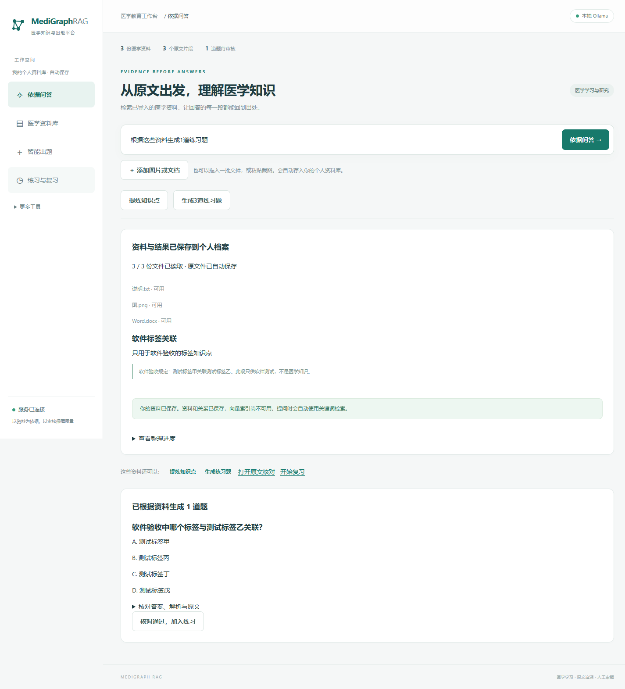
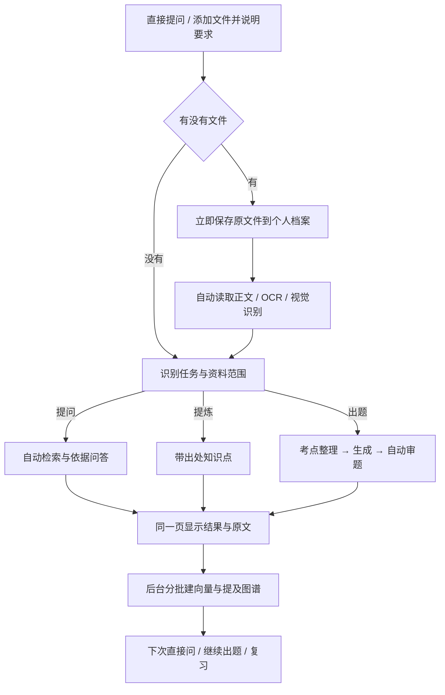
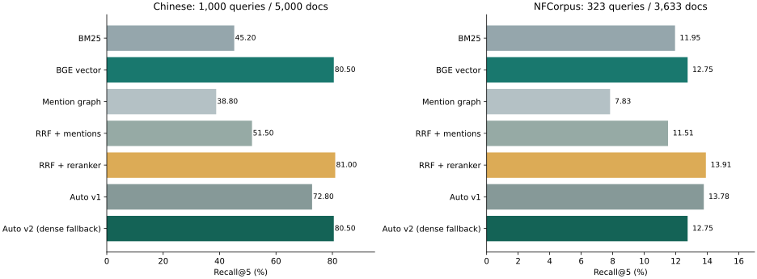
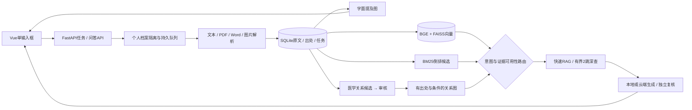

# MediGraphRAG

**医学资料放进来，直接提问、提炼知识点或生成练习题。原文、结果、向量与资料关联自动保存到个人资料库。**

[](https://github.com/hvqo/MediGraphRAG/actions/workflows/checks.yml)


[快速开始](#快速开始) · [使用场景](#怎样用步骤最少) · [检索实测](#真实检索与答案实测) · [技术架构](#怎么实现) · [完整实测报告](docs/MEDICAL_BENCHMARK.md) · [开发进度](docs/PROGRESS.md)

> 0.6.0 · 开发和推送只在 `refactor/medigraphrag`。main 保持原状态，原 main 的备份分支仍保留。
> 下列界面截图来自真实浏览器中的非临床验收资料与明确标记的模型桩；真实医学数据/模型实验另见评测报告。


## 怎样用，步骤最少

首次完成本地或云端模型配置后，常用任务都从一个输入框开始，用户无需选择检索方式、解析器、向量模型或图数据库。

| 场景 | 用户只需要做什么 | 后台自动做什么 |
|---|---|---|
| 查医学知识 | 输入问题，发送 | 判断关系/比较等意图；语义优先，必要时查审核图路径；无索引自动回退关键词；返回引文 |
| 看教材截图 | 粘贴或拖入图片，输入问题 | 识别文字/图示，保留原图，围绕本批资料回答并归档 |
| 从教材出题 | 批量添加图片、PDF、Word，说“生成3道题” | 解析→整理带出处考点→出题→逐项审查；同页显示题目、答案与原文 |
| 只想先存一批资料 | 拖入文件，点击“提炼知识点” | 先完成摘要，再后台分批建向量和资料提及关系；不用另外点建库 |
| 继续处理同一批资料 | 点击“生成练习题”或直接追问 | 复用本批资料范围；不用重新上传或再选文档 |
| 恢复昨天的任务 | 展开“继续上次的资料任务” | 从持久化记录恢复结果、处理进度和后续入口 |
| 教师准备练习 | 核对题目后点击“加入练习” | 保留人工审核门槛、原文失效检查和版本记录 |

默认只有4个常用导航；蓝图、评测、关系审核、设置等放入“更多工具”。用户结果先显示，向量与关系整理在后台继续。结果旁提供提炼考点、再出题、原文核对和复习入口。





## 功能与实现

| 能力 | 实现与边界 |
|---|---|
| 自动多格式导入 | 图片、原生/扫描PDF、DOCX含内嵌图、TXT/Markdown；批量最多100份，每份25MB。旧DOC需另存DOCX；不声称支持所有复杂版式 |
| 医学依据问答 | 自动检索→结构化生成→逐字引句核验→独立模型复核；没有有效依据则明确返回不足 |
| 自适应RAG | `dense-first-v2`；日常语义召回，有审核关系时按意图深查，无有效图路径回退；规则可解释，不输出伪置信概率 |
| 原文阅读 | PDF.js页内定位、文字高亮、选择文字提问；原图回看、Word段落/表格、出处与版本 |
| 自动归档 | 每个本机浏览器档案独立SQLite、原文件、任务、FAISS索引和关系。首次档案复制旧资料，保留原目录 |
| 图谱 | 自动保存字面提及关系；医学语义关系可提取为候选，经过人工核对后才作为深检索依据。图不完整时仍可检索原文 |
| 可审核出题 | 单选、多选、蓝图、病例、逐项干扰项审查；失败候选留存，教师确认后进入练习与默认导出 |
| 学习与反馈 | 先答后看解析、错题回到原文、题目版本快照；真实作答样本不足时不伪造难度统计 |
| 模型与追踪 | Ollama / OpenAI兼容HTTP；本地或云端可切换；记录模板、调用量、耗时与原文指纹，密钥不入Git |
| 持久任务 | 先保存原文件，再完成用户请求；后台索引逐批让出队列；重启恢复与明确失败重试 |


## 真实检索与答案实测

本轮已下载并实际加载完整BGE和重排权重，收集公开医学/生物医学数据运行对照。不是用随机向量替代。逐题排名、指标和模型输出判定均有JSON记录。

**中文 MedicalRetrieval：全部1,000个dev查询；5,000篇受控检索子集，包含所有已标注正例。不是100,999篇全库榜单成绩。**

| 方案 | Recall@5 | MRR@5 | nDCG@5 | 检索P50 | 检索P95 |
|---|---:|---:|---:|---:|---:|
| BM25关键词 | 45.20% | 0.3861 | 0.4026 | 0.44ms | 1.90ms |
| 真实BGE向量 | 80.50% | 0.7314 | 0.7497 | 17.40ms | 23.10ms |
| 字面提及图 | 38.80% | 0.3277 | 0.3429 | 0.14ms | 0.35ms |
| 关键词/向量/提及图融合 | 51.50% | 0.4315 | 0.4521 | 19.04ms | 25.94ms |
| 关键词/向量召回 + 重排 | 81.00% | 0.7015 | 0.7286 | 126.52ms | 184.72ms |
| 旧自动策略v1 | 72.80% | 0.6049 | 0.6356 | 18.25ms | 23.79ms |
| 新自动v2的语义回退路径 | 80.50% | 0.7314 | 0.7497 | 16.82ms | 22.02ms |



计时为RTX4050 6GB、单并发预热后的检索内核，包含真实查询编码和相应重排；不含HTTP、SQLite载入、冷启动或答案生成。应用默认CPU索引/编码与该GPU延迟不可混为一谈。

**选择：日常语义优先，关系问题按需补充有效审核路径，索引未就绪则关键词回退。** 原因是中文重排只增加0.5个百分点R@5却明显变慢，且MRR/nDCG下降；字面共现融合可能破坏排序。英文NFCorpus中重排nDCG@5为0.3976，向量为0.3736，因此保留研究/质量场景的重排能力。没有一套方案在所有集合上最好。

**找得到，不等于答得对。** PubMedQA的60题均衡专家标签样本、1,000摘要检索池中：关键词答案准确率53.33%、向量56.67%、字面图48.33%、融合50.00%、重排55.00%、旧自动53.33%、新自动56.67%。新自动虽然检索R@5为100%，答案仍有26/60错误；该56.67%的95%区间约44.1%–68.4%，不能当临床诊疗准确率。

完整P@5/10、R@5/10、Hit、MRR、nDCG、P50/P95、引句匹配率、无效输出率、混淆矩阵、逐题记录、复现命令及局限见 **[真实医学评测报告](docs/MEDICAL_BENCHMARK.md)**。v2是本轮数据驱动的开发选择；公共集合没有已审核医学多跳金标准，故未证明图深检索的临床收益，也未完成独立留出集验证。

本机多模态验收：同一公开摘要的PNG、扫描PDF、Word内嵌图各1份，文字优先流程110.48秒完成1道题并自动建好索引；整次问答API11.31秒。视觉基线431.73秒，另一次优化中出题失败的记录也保留。只做了一个干净打印样本，不能据此宣称自然文档OCR总体速度或准确率；图示仍按需调用视觉模型。详见报告。

## 怎么实现



| 层 | 技术 | 主要目录/模块 |
|---|---|---|
| 界面 | Vue3、Vue Router、Pinia、TypeScript新入口/模块、Vite | `frontend/src` |
| 阅读与图 | PDF.js、ECharts、图片原图 | 阅读器与图谱页面 |
| API与校验 | Python、FastAPI、Pydantic | `backend/app` |
| 数据与队列 | SQLite、5次增量迁移、异步优先队列、分批索引、浏览器档案Cookie | `storage` / `operations` / `personal` |
| 多模态 | pypdf、DOCX XML、Pillow、pypdfium2、RapidOCR/ONNX、Ollama Qwen2.5-VL | `documents` / `multimodal` |
| 检索 | BGE、FAISS、内存倒排BM25、RRF、受控图路径、可选重排 | `ranking` / `retrieval` / `routing` / `relations` |
| 教学与质量 | 结构化HTTP、逐字出处校验、独立审题、版本失效、调用记录 | `llm` / `evidence` / `questions` / `teaching` |
| 工程 | unittest、Ruff、Prettier、vue-tsc、Playwright/Chrome、GitHub Actions | `tests` / `scripts` / `.github` |

正式代码全部是`.py`、`.vue`、`.ts`、`.css`等常规文件。原Notebook的61个代码单元迁入`legacy`，来源与校验清单保留，见[源码布局](docs/SOURCE_LAYOUT.md)。

## 快速开始

保持现有Python即可；本机实测环境是Python3.10.10。已配置环境的用户直接启动，不必重建环境或重新下载已有模型。

```powershell
# 在仓库根目录，先激活已有虚拟环境
python -m pip install -r requirements-ocr.txt
python -m pip install -e .
cd frontend
npm ci
npm run build
cd ..
python -m backend.app.cli serve
```

打开 **http://127.0.0.1:8000**。本机现有环境位于`E:\chatgpt\rag\MediGraphRAG\.venv`。

本地文字模型默认Ollama `qwen2.5`，图示识别使用`qwen2.5vl:7b`；已有模型直接复用。云端文字生成在设置中切换；当前视觉识别使用本地Ollama，不声称所有云端接口支持图片。

真实向量与公共基准的可选依赖/资产：

```powershell
# 安装适合本机CUDA/CPU的PyTorch后，再装检索依赖
python -m pip install -r requirements-benchmark.txt
python scripts/prepare_medical_assets.py
```

脚本下载固定版本的中英文BGE、重排模型与公开数据，校验SHA256，存入被Git忽略的`.runtime`。普通使用只需准备模型；自动上传流程会在后台建索引，无需每次运行评测脚本。数据许可与实验范围见报告。

开发前端可用`npm run dev`；通过Vite同源代理访问API，默认生产访问也是前后端同源。

## 数据与实际边界

- `.runtime/libraries/<档案ID>`保存每个档案的数据库、原文件、任务、向量和关系；备份应保留整个`.runtime`及浏览器身份。首次个人档案会复制旧库和设置，原库保留。
- 当前“个人档案”是本机浏览器身份隔离，**不是账号登录、跨设备同步或公网多租户认证**。清除Cookie会进入新档案，旧数据仍在磁盘；不要把该版本直接暴露为公网医疗服务。
- 自动提及关系只说明原文出现某术语，不能当治疗/诊断/因果事实。医学语义关系需审核；SQLite已实际工作，Neo4j仅有可选同步适配，未实连。
- 图片与扫描页转换为可引用文本后进入同一文本向量索引；尚无独立图像embedding或跨模态召回成绩。保留原图/原页核对，不能把OCR后的引用存在等同于原图识别正确。
- 长文知识点提炼有明确采样范围，当前最多取12份资料的代表片段、8个考点，不声称逐页覆盖；完整正文仍归档可检索。大批出题可使用蓝图功能。
- 引用匹配与模型复核不能证明临床正确；本项目面向医学教育与研究，真实专家语义审核、自然场景OCR和医学多跳独立评测仍需补齐。

## 验证与文档

```powershell
python -m unittest discover -s tests -v
ruff check backend tests scripts main.py
ruff format --check backend tests scripts main.py
python scripts/check_repository.py
python scripts/check_v2_ui.py --capture-docs
# 真实模型，隔离资料库，耗时较长
python scripts/check_multimodal_model.py
cd frontend
npm run format:check
npm run typecheck
npm run build
```

- [医学评测与逐题结果](docs/MEDICAL_BENCHMARK.md)
- [极简交互、任务优先与个人资料库设计](docs/PERSONAL_WORKSPACE.md)
- [自动RAG与图谱的设计演进](docs/ADAPTIVE_RAG_DESIGN.md)
- [蓝图、病例、学习与版本使用说明](docs/V2_GUIDE.md)
- [阶段进度与已知限制](docs/PROGRESS.md)

架构参考官方项目：[GraphRAG](https://microsoft.github.io/graphrag/query/overview/)、[LightRAG](https://github.com/HKUDS/LightRAG)、[RAG-Anything](https://github.com/HKUDS/RAG-Anything)、[MedRAG](https://github.com/gzxiong/MedRAG)。本项目没有冒用这些框架的评测成绩。
