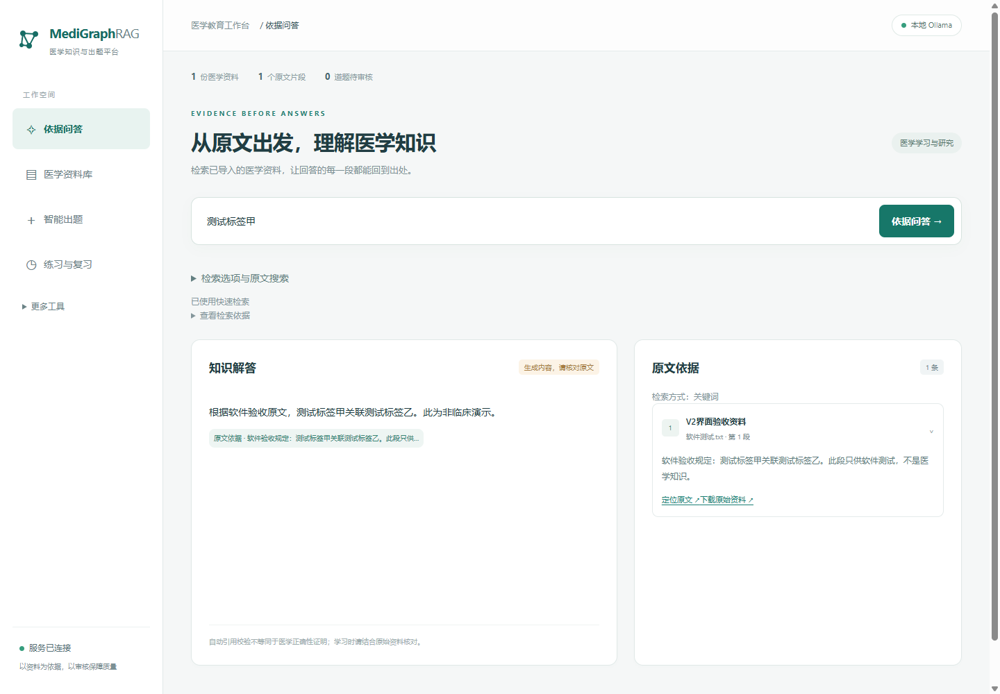
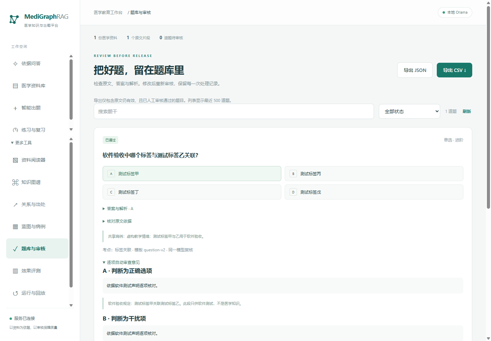
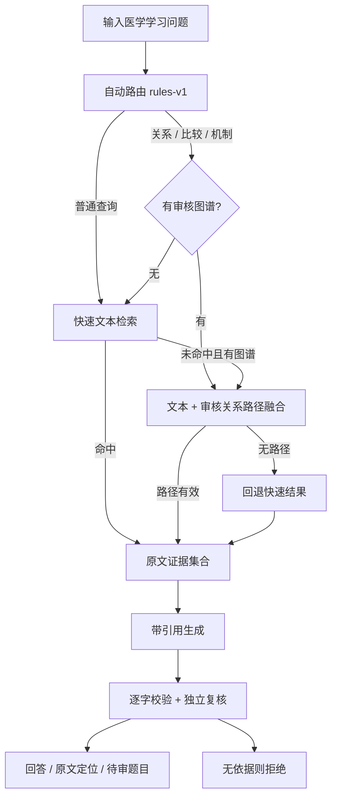
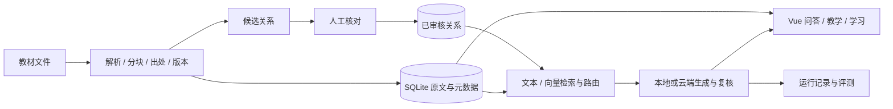

# MediGraphRAG

**面向医学教育的资料检索、带出处问答与可审核出题工作台。**

导入教材后直接提问。普通问题快速查原文，关系问题按需补充审核图谱；回答、题目和每条关系都能回到资料。

[](https://github.com/hvqo/MediGraphRAG/actions/workflows/checks.yml)


[快速开始](#快速开始) · [功能](#能做什么) · [检索实测](#检索方案到底哪个好) · [技术实现](#技术实现) · [后续架构](docs/ADAPTIVE_RAG_DESIGN.md) · [开发进度](docs/PROGRESS.md)

> 当前开发分支：`refactor/medigraphrag`。main 已备份并同步源码整理版，本轮增强继续提交到改造分支。
> 截图来自真实浏览器中的**非临床软件验收资料和本地模型 HTTP 桩**，用于展示交互，不表示医学回答效果。



## 能做什么

| 功能 | 用户得到什么 | 如何实现 |
| --- | --- | --- |
| 医学资料库 | PDF、DOCX、TXT、Markdown、粘贴文本；去重、原文件下载 | 保留文件与页码/段落，按片段入库；原生 DOCX 保留表格顺序 |
| 依据问答 | 回答每段有出处，点击定位原文 | 检索→结构化生成→逐字引文校验→独立模型复核；无有效依据则拒绝 |
| 自动检索 | 普通使用无需选择关键词、向量或图谱 | 规则路由 `rules-v1`；快速文本检索与有界关系检索，保留实际路径与回退原因 |
| 资料阅读器 | PDF 页内高亮、选择文字问答/出题 | PDF.js 文字层匹配引句，记录页码、片段和可选版面坐标 |
| 关系与图谱 | 每条关系有原句、适用条件和审核状态 | 模型提取或手工录入→人工审核→最多2跳路径；共现与医学事实分开 |
| 出题与病例 | 单选、多选、病例；按章节/考点/认知层次组织整卷 | 蓝图排队生成，共享审核病例，逐项审查干扰项；失败候选不进入正式题库 |
| 题库审核 | 编辑重审、审核记录、JSON/CSV、整卷导出 | 原文有效且人工审核通过的题目才进入默认导出与练习 |
| 学习反馈 | 先答后看解析，错题回到知识点与原文 | 本机学习档案、题目版本快照；真实首次作答达到阈值才显示统计 |
| 版本与追踪 | 看资料更新影响，查运行失败原因 | SQLite 增量迁移、资料指纹、题目来源变化留痕、模型/模板/调用量/耗时/回放 |
| 模型选择 | 本地或云端，生成与审题可选不同模型 | Ollama / OpenAI-compatible HTTP；密钥不通过读取接口返回、不入 Git |



### 日常操作尽量少

首次配置模型后：**添加资料 → 输入问题 → 提问**。系统选择检索路径，用户核对回答旁的出处即可。

- 默认导航从12项收拢为**依据问答、医学资料库、智能出题、练习与复习**4项；管理功能仍可从“更多工具”打开。
- 手动检索选择、仅查原文、路由解释与耗时放入折叠区。
- 一次提问只发起一次 `/ask`，由后端完成检索与回答；取消原来先 `/search` 再 `/ask` 的重复检索。
- 关系和题目的人为审核仍保留；“少操作”不意味着自动把候选当作医学事实。

批量拖入、后台自动索引、连续对话、回答一键转练习、出处抽屉属于[下一阶段交互方案](docs/ADAPTIVE_RAG_DESIGN.md#让操作接近日常聊天)，**尚未全部实现**。

## RAG 与知识图谱怎样配合

本项目已结合文本 RAG 与有出处的审核关系，但当前是**有界路径增强检索**，不是完整的社区摘要/全局 GraphRAG。



| 模式 | 实际内容 | 使用位置 |
| --- | --- | --- |
| `auto` 默认 | 简单问题先快速检索；明确关系问题直接走深路径；未命中/缺图谱时有界尝试或回退 | 日常问答与出题 |
| `keyword` | 中文2/3字片段与英文词、BM25风格打分 | 基线、精确术语、无需模型 |
| `vector` | BGE 归一化 CLS 向量 + FAISS 内积 | 需要完整真实权重与有效索引；缺失时明确未运行 |
| `graph` | 已审核、原文仍有效的关系路径所对应的证据 | 路径核对；只查图会受图谱覆盖率限制 |
| `hybrid` | 文本、共现候选、审核路径、可选向量的排名融合；可选重排 | 强制对照与复杂检索 |

快速路径启用向量时使用关键词+向量RRF；当前本机没有完整 BGE 权重，所以本轮实测的快速路径实际为关键词。
图路径目前从 SQLite 审核记录读取，最多2跳、30条路径，并遵守当前资料/片段范围。
Neo4j 同步适配已经接入，**在线 Neo4j 深检索与真实服务连接尚未验收**。
共现只扩展候选，不作为因果、诊断或治疗事实。

## 检索方案到底哪个好

**没有一个已被证明在所有任务上最优的方案。当前把自动路由作为产品默认，保留其他模式做对照。**
以下为2026-10-27本机实跑数据，完整样本、配置、源码指纹和结果已公开在[benchmarks](benchmarks/README.md)。

### A. 有明确标准答案的软件功能集

48份非临床文本、16条构造关系、20个独立查询：8个直接查找、8个两跳问题、4个不可答。
Top-K=5；每个模式重复5轮计时。质量指标仅计算16个可答查询，拒答另计。

| 策略 | 证据 Recall@5 | MRR | 检索 P50 | 检索 P95 |
| --- | ---: | ---: | ---: | ---: |
| 关键词 BM25 风格 | 75.0% | 1.0000 | 2.77 ms | 4.44 ms |
| 语义向量 BGE / FAISS | 未运行 | — | — | — |
| 审核图谱（仅关系） | 100.0% | 0.9062 | 4.59 ms | 6.06 ms |
| 固定融合 | 100.0% | 1.0000 | 7.45 ms | 15.42 ms |
| 自动路由（默认） | 100.0% | 1.0000 | 7.88 ms | 14.99 ms |

这里关键词在两跳子集的证据召回为**50%**，图谱/融合/自动为**100%**：图谱补回了另一段证据。
四种可运行模式对4个不可答查询均返回空结果。**这是构造数据的功能结果，不是医学准确率，也不是独立路由泛化实验。**
自动模式的P50不比固定融合更低，因此不能宣称“自动一定更快”；不同任务占比和图谱覆盖会改变结果。

### B. 原仓库医学文本的弱标注来源查找

从历史知识数据固定采样500条，去重后499份文本，选80条的前12个字符作为查询；每种模式重复3轮计时。
这个设置偏向词面查找，只检验能否找回已知来源，**不检验医学知识真假、同义改写或答案正确性**。

| 策略 | 已知来源命中@5 | MRR | 检索 P50 | 检索 P95 |
| --- | ---: | ---: | ---: | ---: |
| 关键词 BM25 风格 | 100.0% | 0.9812 | 46.41 ms | 66.94 ms |
| 语义向量 BGE / FAISS | 未运行 | — | — | — |
| 审核图谱（仅关系） | 未运行 | — | — | — |
| 固定融合 | 100.0% | 0.9812 | 72.96 ms | 106.21 ms |
| 自动路由（默认） | 100.0% | 0.9812 | 45.43 ms | 67.41 ms |

这个测试没有审核图谱，也没有真实向量索引，因此图谱/向量为“未运行”，不能拿0分参与算法排名。
其他相关来源没有穷举标注，Precision无法估计；上表的100%也不能写成“医学召回率100%”。

### 指标应怎样理解

- **Recall@5**：前5条找回多少已标注证据；**MRR**：第一个正确来源越靠前，值越高。
- **P50/P95**：预热后本机进程内检索耗时，包含数据库、分词、路由和关系读取；**不含HTTP、建索引、答案生成与独立审题**。
- **医学答案准确率、依据支持率、真实语义向量质量、完整回答速度**：目前没有足够独立实测，保持“未测”，不以检索命中率替代。
- 三个旧软件样例全部命中只是冒烟测试；上面两组也仍有样本小/弱标注偏差，不能据此承诺生产质量。

结论与完整指标、复现命令、局限、下一轮医学金标准方案见[检索评测报告](docs/RETRIEVAL_EVALUATION.md)。

## 技术实现

| 层次 | 技术 | 对应模块 |
| --- | --- | --- |
| 前端 | Vue 3、Vue Router、Pinia、TypeScript（新入口/新模块）、Vite | `frontend/src` |
| 原文阅读/图展示 | PDF.js 文字层、ECharts | 阅读器、共现图谱 |
| 后端与数据校验 | Python、FastAPI、Pydantic | `backend/app` |
| 持久化 | SQLite、4次增量迁移、原文件保留 | `storage.py` / `migrations.py` |
| 解析与出处 | pypdf、DOCX XML、文本分块、版本与指纹；Docling可选 | `documents.py` / `parsing.py` / `provenance.py` |
| 检索 | BM25风格关键词、RRF、有界审核图路径；BGE/FAISS/重排可选 | `retrieval.py` / `routing.py` / `relations.py` |
| 生成与教学 | Ollama/云端结构化HTTP、串行出题任务、独立审题 | `llm.py` / `questions.py` / `teaching.py` |
| 质量与学习 | 固定集对照、调用回放、版本化作答记录 | `evaluations.py` / `learning.py` |
| 工程验证 | unittest、Ruff、Prettier、vue-tsc、Chrome/Playwright、GitHub Actions | `tests` / `scripts` / `.github` |



所有 Notebook 已迁出，正式应用使用 `.py` / `.vue` / `.ts` / `.css`；历史实验隔离在 `legacy`，原61个代码单元可追溯。
目录及迁移校验见[源码整理](docs/SOURCE_LAYOUT.md)。

## 多模态做到哪里了

| 能力 | 状态 |
| --- | --- |
| 原文件、PDF页码/文字层/高亮 | 已实现 |
| 原生DOCX基础表格与可选版面字段 | 已实现基础能力，不代表复杂表格理解已验收 |
| Docling增强解析 | 已有可选适配器，当前环境未安装、未实测OCR |
| 图片输入、图像embedding、图文联合证据、视觉模型看图 | 设计阶段，未接入 |

下一阶段优先处理**教材扫描页、表格、流程图和示意图**：统一页码/坐标/模态证据结构，结合图注、OCR和周边正文召回，必要时读取原图。
之后再做跨模态向量对照；患者影像诊断不属于当前任务范围。
详细分层设计和交互目标见[自适应RAG与多模态方案](docs/ADAPTIVE_RAG_DESIGN.md)。

## 快速开始

核心应用 Python 3.10+；前端构建使用 Node.js 24。已有环境无需再次更换Python。

```powershell
python -m pip install -e .
cd frontend
npm ci
npm run build
cd ..
python main.py
```

打开 [本机工作台](http://127.0.0.1:8000)；[API文档](http://127.0.0.1:8000/docs)。构建后由后端提供页面，无需同时启动两个服务。
本Windows工作区复用现有环境：`& ..\.venv\Scripts\python.exe main.py`，或 `scripts/start.ps1`。

1. 在“更多工具 → 模型与设置”配置一次本地Ollama或云端地址/模型并检查连接；生成和审题可选不同模型。
2. 在“医学资料库”导入教材；轻量解析与关键词检索不依赖BGE或Neo4j。
3. 回到“依据问答”直接提问；出题后在题库核对原文，再发布到练习或导出。

可选语义模型安装/配置、模型目录、Neo4j环境变量、Windows适配、数据备份和完整使用说明见：
[环境说明](ENVIRONMENT-WINDOWS.md) · [V2使用指南](docs/V2_GUIDE.md)。

`.runtime` 保存原文件、SQLite、设置与索引，已排除Git；备份时保留整个目录。
云端调用会向所选服务发送检索片段，费用由服务商计收。默认绑定本机，当前没有多用户权限隔离。

## 开发与复现

```powershell
python -m unittest discover -s tests -v
ruff check backend tests scripts main.py
ruff format --check backend tests scripts main.py
python scripts/check_repository.py
python scripts/compare_retrieval.py --suite functional --repeats 5 --output benchmarks/results/functional-v1.json
python scripts/compare_retrieval.py --suite legacy --repeats 3 --output benchmarks/results/legacy-lookup-v1.json
cd frontend
npm run format:check
npm run typecheck
npm run build
```

`check_v2_ui.py` 在临时数据与明确标记的HTTP模型桩下检查12页和联动流程；
`check_reader_ui.py` 验证真实PDF定位；`check_local_model.py` 实际调用本机Ollama，非医学准确率评测。
截图可通过 `python scripts/check_v2_ui.py --capture-docs` 重建。

## 当前边界与下一步

- 核心界面与来源、路由、审核流程已实现；完整BGE、Neo4j实连、多模态和专业医学金标准仍待验收。
- 规则路由不是学习型医学意图模型；字符串实体匹配与2跳路径不等同于全局医学推理。
- 自动引用校验只证明引句匹配，不能证明语义支持或临床正确；教师审核仍是题目发布门槛。
- 真实学生样本不足时不计算难度/区分度，不用生成要求替代真实测量。
- 下一步按“独立医学评测 → 稳定语义/关系融合 → 异步导入与少操作 → 教材多模态”推进。

架构借鉴与官方资料：[Microsoft GraphRAG](https://microsoft.github.io/graphrag/query/overview/)、
[LightRAG](https://github.com/HKUDS/LightRAG#selecting-query-modes)、[RAG-Anything](https://github.com/HKUDS/RAG-Anything)、
[MedRAG](https://github.com/gzxiong/MedRAG)。这些项目的结果不是本项目的成绩，尚未在本机做框架间公平对比。
