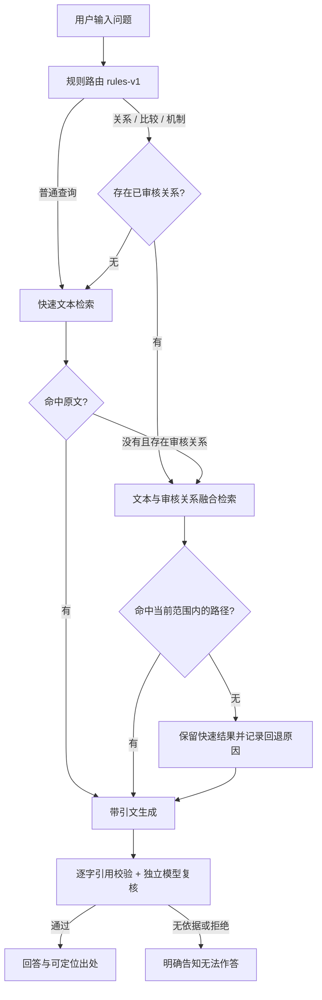
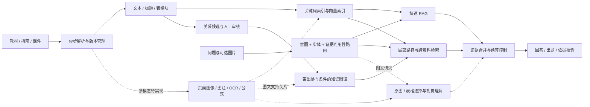

> 0.6已加入真实BGE、倒排缓存、语义优先、图片/扫描PDF/Word图识别和个人档案；下方保留0.5设计演进。 最新行为与数据以[医学评测](MEDICAL_BENCHMARK.md)和[个人工作台](PERSONAL_WORKSPACE.md)为准。旧“向量/多模态未测”为历史状态。

# 自适应 RAG、图谱深检索与极简交互

状态：2026-10-27。**本轮已落地规则路由和界面收拢；完整多模态、学习型路由与大规模图推理是后续方案。**

## 为什么要改

0.4.0 具备资料、引用、题库和关系审核，但默认把多种召回拼在一起，用户要理解四种检索方式，导航有12项。
它还不是自动选择路径的 Adaptive RAG；“有图谱”也不意味着已实现社区摘要、全局推理或多模态。
本轮把常用体验与检索策略分开，先让产品可用，再用受控评测决定增加哪些复杂度。

## 本轮已经落地的路径

- 快速路径：中文2/3字片段与英文词分词、BM25风格打分；启用向量且索引有效时，再用RRF融合文本向量候选。
- 深路径：文本候选、已审核且来源仍有效的关系路径、可选向量、可选重排。共现只用于候选扩展，不当成医学事实。
- 明确的关系问题先分流，避免先查一遍再重复同一轮文本/向量召回。普通问题未命中时允许一次深检索尝试。
- 深检索最多2跳、30条路径；人工审核是事实使用门槛。路径中的每条边都回到原句，多条边不自动构成新结论。
- `routing` 返回策略版本、触发原因、实际路径、是否尝试图谱、回退原因与耗时。它是规则判断，不是医学置信概率。
- 当前图关系路径来自 **SQLite 中的审核记录**；Neo4j 已有同步适配，但尚未成为本轮在线检索后端。
- `auto` 是当前产品默认；`keyword/vector/graph/hybrid` 保留在高级选项和评测台，方便强制覆盖、对照与排查。

这次选择自动路由的理由是：减少用户选项、普通问题避免无必要的图谱扩展、复杂问题有可查证的补充依据。
并不是已经证明自动模式的医学准确率最高。固定融合可能在某些负载下更快，纯图谱可能漏掉尚未建图的事实。

## 下一阶段的完整架构

### 路由升级

1. 先用现有规则作为可解释基线，收集真实问题和路由纠错，不把RRF分数硬当置信概率。
2. 增加医学实体别名、实体链接、版本/适用范围过滤。只有在验证集上校准过的证据充分度才能用于阈值决策。
3. 比较规则、小分类器和可选LLM路由的质量、额外耗时与调用成本；保留人工覆盖。
4. 弱证据、矛盾版本或多实体链条触发有预算的重检索；生成前固定证据集合，复核拒绝时不能无限重试。
5. 多文档总体问题再评估全局主题/社区摘要。没有代表性评测前，不直接引入完整 GraphRAG 的索引成本。

当前关键词分数仍按请求读取/分词计算，SQLite图路径也会读取审核记录；尚无持久化倒排索引或检索缓存。
规模扩大后需分别比较内存BM25快照、倒排索引、图邻接缓存和独立向量/图服务，按资料指纹失效；
小样本的毫秒级结果不能外推到全量教材规模。

### 图谱深检索

图谱要记录稳定实体ID、类型、别名、关系方向、否定、适用条件、资料年份/版本和原句。
先做“实体定位 → 有界路径 → 每条边原文 → 同版本过滤 → 候选重排”，再评估全局摘要。
对于某条关系缺失的情况，必须能回到原文检索；图谱覆盖不全时不能只查图。
当前以字符串匹配实体、双向浏览相邻边，属于有出处的路径浏览，尚不支持完整实体消歧或因果推理。

## 多模态要做到哪一步

**第一阶段：教材内容。** 支持扫描页OCR、表格、流程图、解剖示意图、图注与公式，保留原页和坐标。
建立统一证据单元：`document_version / page / bbox / modality / original_asset / caption / OCR / table_headers`。
先用图注、OCR和周边段落定位候选，再在确有图文请求时调用视觉模型读取对应原图。
回答同时展示图中区域、原始表格或正文；图片生成的描述是衍生信息，不能替代原图。

**第二阶段：结构化表格检索。** 保留行列标题、单位、脚注、跨页关系，不只把数字打平成一段话。
对“比较表中两行”等请求返回相关单元格，并独立评测数字/单位/否定信息是否正确。

**第三阶段：原生跨模态检索。** 在具备图像检索金标准后，再比较图文embedding、页面视觉向量和文本代理检索。
教材图文理解与患者医学影像诊断是不同任务；后者不列入本项目当前承诺。

当前只能说“文本检索、原文PDF显示、基础表格保留、Docling可选适配”；没有图片输入API、图像embedding或VLM证据链，不能写成已支持完整多模态RAG。

## 让操作接近日常聊天

| 场景 | 本轮已实现 | 下一阶段目标，尚未实现 |
| --- | --- | --- |
| 开始使用 | 常用导航只保留问答、资料、出题、练习4项；其他收进更多工具 | 首次配置一次模型；按教师/学习者显示不同首页 |
| 提问 | 输入问题→一次点击；自动路由；单次 `/ask` 完成检索与回答，不重复请求 `/search` | 连续对话、自动跟随当前资料和上下文 |
| 添加资料 | 空库在问答页直接链接添加资料 | 拖入文件即进入后台解析/索引队列；显示可读状态，不要求懂分块/FAISS |
| 高级配置 | 四种手动检索放入折叠区；路由原因和耗时按需展开 | 按设备给出推荐预设，失败时明确提示当前可用能力 |
| 出题 | 单题、蓝图和原文出题入口均保留 | 回答旁“一键转练习题”，自动继承考点、原文和病例上下文 |
| 引用核对 | 一次点击跳到阅读器页码/片段 | 在同一抽屉预览，减少页面往返 |
| 学习反馈 | 提交即看解析、依据和错题知识点 | 自动安排下一道适合复习的题，减少手工筛选 |

“无感”是自动完成可逆的机械步骤，不是静默审核医学关系或跳过教师审题。
上传→检索可自动化；将候选关系当成事实、将新题发布给学习者仍保留明确的审核动作。

## 怎么证明改造有效

- 第一层：代码与流程测试，验证路径、来源失效、可覆盖、少一次重复请求和手机布局。
- 第二层：本轮公开的自建功能集与历史医学文本弱标注查找测试，见 `RETRIEVAL_EVALUATION.md`。
- 第三层：下一轮准备200条中文教材问题：80条直接事实、60条跨段/两跳、30条表格/图片、30条不可答。
  两位专业审核者确认正例、其他相关证据、最小充分证据集与答案，争议裁决，固定开发/测试划分。
- 在相同资料、模型、Top-K、上下文预算和版本下比较 BM25、向量、混合、图谱增强和自动路由。
  另做重排开/关、1/2/3跳、别名开/关、OCR/表格/视觉增量的消融。
- 分别报告 Recall@K、完整证据集命中、MRR/nDCG、答案准确率、依据支持度、不可答拒答、P50/P95、首字/完整回答延迟和每次调用成本。
  先用基线验证，再谈更换默认策略；少量简单题全对不能作为生产准确率。

## 调研依据

下面是架构借鉴，未部署这些项目、未搬用其评测成绩：

- [Microsoft GraphRAG 查询引擎](https://microsoft.github.io/graphrag/query/overview/)区分基础、局部、全局和DRIFT查询。借鉴按问题选择检索路径，不能把目前的2跳浏览称作完整DRIFT。
- [LightRAG 查询模式](https://github.com/HKUDS/LightRAG#selecting-query-modes)提供 local/global/hybrid/naive/mix。借鉴文本与关系联合召回；其模式名字、默认值或性能不等同于本项目。
- [RAG-Anything](https://github.com/HKUDS/RAG-Anything)提供图文、表格等内容处理与跨模态图思路。借鉴统一证据结构，按需选择解析/视觉部件，不为“功能多”直接整体替换后端。
- [MedRAG](https://github.com/gzxiong/MedRAG)与其[MIRAGE医学基准](https://github.com/gzxiong/MIRAGE)用于研究医学RAG组件。可借鉴固定数据与组件对照方法，其英文任务成绩不能套用成本项目中文医学准确率。
