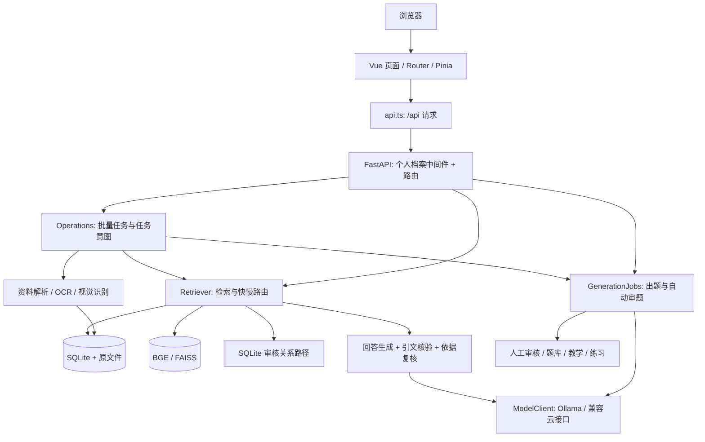
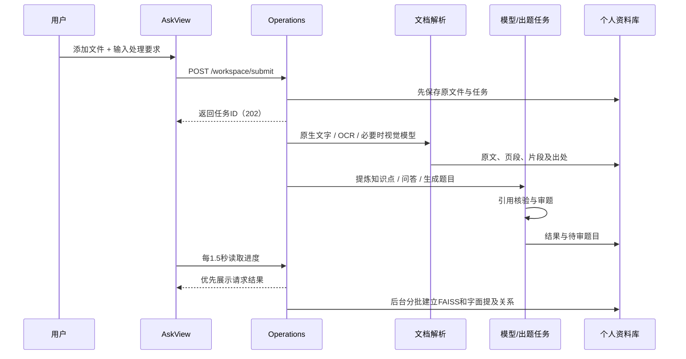

# 代码地图、运行架构与本机演示

核对日期：2026-11-08。基线：main / 866162a / 0.6.0。

2026-11-17更新：目录与主业务链路继续适用；0.7已合入main，模型和启动方法以 [MODEL_UPGRADE.md](MODEL_UPGRADE.md) 为准，支持llama.cpp / LM Studio本地兼容接口及Qwen3-VL-8B。以下原始启动实录保留为0.6历史记录；文件/目录/符号CSV已随本轮源码更新。

本说明依据当前代码核对，不把历史设计文档中的计划当成已实现功能。
逐个受 Git 管理的文件见 [FILE_INVENTORY.csv](FILE_INVENTORY.csv)；逐个目录及文件数见 [DIRECTORY_INVENTORY.csv](DIRECTORY_INVENTORY.csv)。
清点覆盖仓库文件；本地依赖、缓存和用户数据只说明目录职责，不把第三方包逐行列成项目源码。

## 1. 先分清两个路径

- 外层工作目录：`E:\chatgpt\rag`。
- 真正仓库根目录：`E:\chatgpt\rag\MediGraphRAG\MediGraphRAG`，包含 `.git`、`main.py`、`frontend`、`backend`。
- 已有 Python 环境：`E:\chatgpt\rag\MediGraphRAG\.venv`，Python 3.10.10，和仓库是同级目录。

## 2. 当前采用什么架构

**一个仓库中的前后端分离工程，部署为模块化单体。** 前端 Vue 3 / Router / Pinia / Vite，入口和新模块用 TypeScript，部分页面仍是 JavaScript。后端 Python / FastAPI，按资料、检索、出题、教学等业务模块划分。不是微服务，也还没有严格拆成 controller/service/repository 多层目录。

代码层面前后端分开；日常演示时，前端打包产物 `frontend/dist` 由 FastAPI 同时提供，所以只打开 8000 即可。前端开发时才额外启动 5173，代理 `/api` 到 8000。



## 3. 根目录和所有一级目录

| 位置 | 存什么 | 是否参与当前运行 |
| --- | --- | --- |
| `backend/app` | 正式 API、业务逻辑、存储、模型适配 | 是，核心后端 |
| `frontend/src` | Vue 页面、共用组件、路由、状态与样式 | 是，核心前端 |
| `frontend/public` | 原样复制到构建目录的静态资源，如 favicon | 构建使用 |
| `frontend/dist` | 构建后的网页与 JS/CSS/PDF worker | 是；生成物，不是源码 |
| `frontend/node_modules` | npm 安装的第三方依赖 | 开发/构建使用；不上传 Git |
| `docs` | 方案、使用说明、评测报告、开发进度 | 文档 |
| `docs/images` | 当前界面截图、指标图 | README/报告引用 |
| `docs/legacy` | 原版说明、封面图片、Notebook 说明及迁移记录 | 历史文档 |
| `docs/licenses` | PDF.js 等资源的许可文本 | 许可 |
| `benchmarks` | 数据/模型版本清单、测量环境 | 评测资源清单 |
| `benchmarks/results` | 真实检索、问答、多模态及功能实验 JSON | 报告证据；不是在线用户库 |
| `scripts` | 启动、环境适配、校验、资产下载、评测工具 | 按需手动运行 |
| `tests` | 后端自动化测试 | 开发检查 |
| `legacy/agent` | 原版 MetaGPT 知识清洗/出题角色 | 正式后端不调用 |
| `legacy/utils` | 原版嵌入、建图、重排、生成和 Word 导出 | 历史参考 |
| `legacy/experiments` | 三个 Notebook 的代码单元迁出的 Python 文件 | 历史实验，不是在线入口 |
| `legacy/prototypes/data` | 原版知识抽取、图规范化、Neo4j 建库原型 | 历史参考 |
| `legacy/prototypes/rag` | 原版嵌入、FAISS、Neo4j 查询、RAG 原型 | 历史参考 |
| `web/api`、`web/backend` | 旧启动路径的兼容别名，转到 `backend.app.main` | 兼容入口，无重复后端 |
| `config` | 旧模型/MetaGPT YAML 配置 | 主要给旧实现；当前网页设置不读这些 YAML |
| `data/medical-books` | 教材 TeX 正文及图片，数量最多的资料文件 | 不会自动导入个人资料库 |
| `data/knowledge` | 原版知识点 CSV/JSON | 历史数据；评测脚本可能使用 |
| `data/graph` | 原版图谱 JSON | 当前 `retrieval.glossary()` 仍会读取实体名称词表 |
| `data/faiss_index` | 原版向量索引及元数据位置 | 不是当前每人一份的向量索引 |
| `model` | 原版模型配置、词表及本地权重候选位置 | 当前模型路径的后备位置 |
| `save` | 原版生成的题目 JSON、Word | 历史导出，不是当前题库 |
| `.runtime` | 当前用户资料、SQLite、原文件、模型和评测缓存 | 是；被 Git 忽略，应单独备份 |
| `.environment-wheels` | Windows 安装时准备的兼容 wheel | 环境安装缓存 |
| `metagpt` | 旧版运行/配置目录 | 旧实现配套；当前服务不依赖其工作流 |
| `workspace`、`logs` | 旧工具工作区和运行日志 | 历史/本地生成物 |
| `medigraphrag.egg-info` | editable 安装生成的 Python 包信息 | 自动生成 |
| `.ruff_cache`、`__pycache__` | 检查器/Python 缓存 | 自动生成 |
| `.git` | 分支、提交、版本历史 | Git 自身数据 |
| `.github/workflows` | main/refactor 的后端测试、前端检查与构建 | GitHub 自动检查 |

根目录文件：`main.py` 是启动器；`pyproject.toml` 定义 Python 包和 CLI；`requirements-runtime.txt` 是当前核心依赖；`requirements-retrieval.txt` 增加向量依赖；`requirements-ocr.txt` 包含核心与 OCR；`requirements-benchmark.txt` 增加评测依赖。`requirements.txt`、`requirements-windows.txt`、锁定文件保留原版/Windows完整环境。`.env.example` 是环境变量示例，实际 `.env` 由 `config.py` 读取；`.gitignore` 控制不上传的文件，`.gitattributes` 控制文件属性，`.editorconfig` 控制编辑格式。

`update.sh` 是旧的直接提交并推送 main 的脚本，**不是启动脚本**；日常演示不要运行它。`environment-check.json`、`environment-packages.json` 是本机安装检查产物。`ENVIRONMENT-WINDOWS.md` 记录本机安装兼容过程。

## 4. 后端逐文件地图

| 文件（均在 backend/app） | 职责 |
| --- | --- |
| `__init__.py` | Python 包标记 |
| `cli.py` | serve、导入资料、search、build-index、status 命令；正式启动入口 |
| `main.py` | `create_app()` 组装模块、生命周期、中间件、静态网页、健康检查与设置 API |
| `config.py` | Settings 校验、settings.json 读写、环境变量、嵌入/重排路径选择 |
| `personal.py` | 浏览器 Cookie 分配本机个人档案，为各库创建隔离应用实例 |
| `storage.py` | SQLite 连接/事务，基础 documents/chunks 表及片段读取 |
| `migrations.py` | 增量数据库迁移：出处、关系、教学、练习、回放、持久化任务 |
| `documents.py` | 原生 PDF/DOCX/TXT/MD 解析、切块、去重、文件存储、重解析 |
| `document_routes.py` | 资料上传、列表、原文件、阅读器、版本、重切块和删除 API |
| `parsing.py` | 可选 Docling 解析适配，没安装时不能当作默认能力 |
| `multimodal.py` | 自动文本优先解析；图片、扫描 PDF、DOCX 内嵌图识别与视觉缓存 |
| `ocr.py` | RapidOCR CPU 文字页识别与可用性筛选 |
| `provenance.py` | 元数据、页段出处、版本链接、来源变化影响及引用失效 |
| `operations.py` | 上传先落盘；任务意图分类；优先处理用户要求，再分批建向量和提及关系 |
| `concepts.py` | 筛除纯来源说明，分散选择正文片段，供0.7分批知识点提炼与覆盖记录使用 |
| `retrieval.py` | BGE 编码、FAISS 构建/有效性、词表、检索、融合、可选重排、自动快慢分流 |
| `ranking.py` | BM25 词面排名、字面提及图排名及倒数排名融合辅助 |
| `routing.py` | `dense-first-v2` 规则路由，判断普通查询和关系/机制/比较意图 |
| `retrieval_routes.py` | `/ask`、`/search`、索引状态/构建、图查询 API |
| `relations.py` | 带原文的关系候选、审核、最多两跳路径、可选 Neo4j 同步与对应 API |
| `llm.py` | Ollama/云端兼容接口、生成与审题配置快照、结构化输出、调用记录 |
| `evidence.py` | 依据问答、引文逐字校验、模型依据复核 |
| `questions.py` | 题目数据结构、题库存储、异步出题任务、生成/引用检查/独立审题 |
| `question_routes.py` | 出题任务、题库详情/编辑/人工审核、JSON/CSV 导出、变更记录 API |
| `teaching.py` | 逐选项审题结构、蓝图组卷、共享病例、教学相关 API |
| `learning.py` | 已审核题练习、提交、错题与知识点统计、复习 API |
| `evaluations.py` | 自建评测集、运行对照、人工评分、模型调用回放 API |

注意：部分模块同时放了请求结构、业务逻辑和路由；路由工厂通过传入 store/model 等对象组织依赖。这是目前实际结构，后续变大后可再拆分，不宜误称已实现严格领域分层。

## 5. 前端逐文件地图

`src/main.ts` 挂载 Vue、Router、Pinia；`App.vue` 是侧栏/顶栏/工作区/全局状态外壳；`router.ts` 定义 12 个业务页面，常用导航显示 4 个；`api.ts` 封装 `/api` 请求和报错；`stores/workspace.ts` 保存服务状态/资料数/待审题数；`types.ts` 放领域类型；`env.d.ts` 是类型环境声明；`style.css` 是全局视觉样式；`pdf-text-layer.css` 是 PDF 文本/高亮样式。

| components 文件 | 页面/组件 | 地址 |
| --- | --- | --- |
| `AskView.vue` | 直接问、批量文件/截图、任务结果与后续操作 | `/#/ask` |
| `DocumentsView.vue` | 资料列表、导入、元数据、版本、重解析/切块、索引管理 | `/#/documents` |
| `ReaderView.vue` | 原文阅读、片段和引用定位 | `/#/reader` |
| `PdfPage.vue` | PDF.js 单页渲染、文本层/高亮共用组件 | 无独立路由 |
| `EvidenceList.vue` | 引文、页段位置、跳回原文共用组件 | 无独立路由 |
| `GraphView.vue` | ECharts 概念关联/知识图可视化 | `/#/graph` |
| `RelationsView.vue` | 原文关系候选、审核、路径和同步 | `/#/relations` |
| `GenerateView.vue` | 可配置题型、数量、难度和范围的专用出题页 | `/#/generate` |
| `BankView.vue` | 人工审题、编辑重审、操作记录、导出 | `/#/bank` |
| `TeachingView.vue` | 蓝图、共享病例与教学生成 | `/#/teaching` |
| `StudyView.vue` | 练习、解析、错题/知识点复习 | `/#/study` |
| `EvaluationsView.vue` | 自建评测和结果比较 | `/#/evaluations` |
| `TracesView.vue` | 模型调用记录与回放 | `/#/traces` |
| `SettingsView.vue` | 本地/云模型、审题模型、检索设备和连接检查 | `/#/settings` |

`package.json` 定义依赖和 npm 命令，`package-lock.json` 固定依赖树；`vite.config.js` 配置 Vue 编译、路径别名和开发代理；`tsconfig.json` 配置类型检查；`index.html` 是 HTML 挂载模板。`src/assets/logo.svg`、`public/favicon.ico` 是静态资源。`frontend/README.md` 仍是简短的 Vite 模板说明，本项目完整操作以本文和根 README 为准。

## 6. 代码实际怎样流转

### 直接问已有资料

1. `AskView.run()` 通过 `api.ts` 向 `/api/ask` 提交问题。
2. `personal.py` 根据浏览器 Cookie 选择该档案的独立数据库；`main.py` 去掉 `/api` 前缀。
3. `retrieval_routes.ask()` 调用 `Retriever.search(mode='auto')`。
4. `routing.decide()` 是规则判断：普通问题优先向量（设置启用且索引有效），否则 BM25 回退。关系/机制等问题尝试审核关系路径，无有效路径则回到快速检索。
5. `evidence.answer_question()` 依据检索片段生成回答 → 检查引用 ID/逐字引句 → 独立模型调用复核支持性 → 返回回答和证据。
6. 前端展示回答和依据；`EvidenceList` 可以跳转 `ReaderView` 回看。

这里的“独立复核”指单独的审查步骤，默认仍可用同一个模型，不等于已配置两个不同模型。当前路由也不是训练出的医学意图分类器。

### 上传资料并要求总结/出题



任务有两层：`Operations` 管批量解析、用户要求、后台归档；`GenerationJobs` 管具体出题。后者重启会标记中断，不是所有出题任务都能自动断点续写。后台优先级在步骤之间生效，正在执行的模型请求不能即时抢占。

知识点当前最多从 12 份资料各抽首个片段（每段最多 650 字），提炼最多 8 点，是样例提炼，不能称为穷尽整批所有知识点。每次请求最多 100 文件、单文件 25MB、PDF 最多 500 页；支持 DOCX，不支持旧 DOC。

### 从生成到练习

`questions.py` 检索依据 → 逐题生成 → 结构/答案/逐字引用检查 → `teaching.AutomaticReview` 逐项复核 → 入库 `pending_review`。用户在题库人工审核后，才可用于练习和默认导出。修改或来源版本变化后可能需要重审；被拦截的候选和失败理由保留。

### 图谱到底在哪里

当前正式服务的关系保存在个人库 SQLite 的 `relations` 表，路径使用 Python BFS，最多两跳/30条路径。`literal_verified` 只表示原文确实提到某词，不代表已确认医学因果；自动深检索要求人工 `approved` 的有效路径。Neo4j 是可选同步/查询适配，默认不要求启动；旧版 MetaGPT/Neo4j 主流程在 `legacy`，不是新服务实时主链路。

## 7. 运行数据在哪里，为什么切浏览器会看不到

```text
.runtime/
├── personal-libraries.json       # 本机浏览器档案登记（含令牌哈希）
├── libraries/<档案ID>/
│   ├── settings.json             # 该档案设置，可能含密钥
│   ├── knowledge.sqlite3         # 资料、出处、关系、题库、任务、练习、回放
│   ├── uploads/                  # 保留的原文件
│   ├── staging/                  # 批量任务已保存、待处理的原文件
│   ├── vectors.index             # FAISS 向量
│   ├── vectors.json              # 片段ID、资料版本与模型签名
│   └── vector-building/          # 分批建索引的中间块
├── models/                       # 已下载的 BGE/重排真实权重
└── medical-data/                 # 公开评测数据与评测向量缓存
```

根 `.runtime` 还保留旧的全局库和检查产物。第一次个人化会复制旧全局库，后续新浏览器档案不会自动复用别人的库。Cookie 是本机身份标记；清 Cookie、无痕、切浏览器、在 localhost 与 127.0.0.1 间切换会得到不同档案。日常统一用 `http://127.0.0.1:8000`。这还不是账号登录/云同步系统。备份应保留整个 `.runtime`，不要上传其中的密钥和个人原文到 Git。

## 8. 本机启动：直接复制即可

目前本机前端依赖与 Python 环境已存在，无需重新安装。下列两个窗口保持打开。

窗口一，启动已有模型（本机历史权重位于 E 盘根目录的 manifests/blobs）：

```powershell
$env:OLLAMA_MODELS = 'E:\'
& 'C:\Users\Administrator\AppData\Local\Programs\Ollama\ollama.exe' serve
```

模型目录设置只对本窗口生效。本机已有用户环境变量指向 `E:\ollama_models`，直接启动时可能读到不同位置；本次使用经核对的 `E:\`，不修改系统永久设置。如果提示端口已占用，且 `ollama list`/设置检查已确认模型可用，不要重复启动。

窗口二，启动网页和后端：

```powershell
Set-Location 'E:\chatgpt\rag\MediGraphRAG\MediGraphRAG'
& 'E:\chatgpt\rag\MediGraphRAG\.venv\Scripts\python.exe' main.py
```

打开 `http://127.0.0.1:8000/#/ask`。API 文档：`http://127.0.0.1:8000/docs`；服务检查：`http://127.0.0.1:8000/health`。关闭自己启动的终端或按 Ctrl+C 停止相应服务。

前端源码有修改时，先构建（然后刷新 8000 页面）：

```powershell
Set-Location 'E:\chatgpt\rag\MediGraphRAG\MediGraphRAG\frontend'
npm run build
```

日常改前端需要即时预览时，保持 Python 后端运行，再在 frontend 执行 `npm run dev`，打开终端给出的 5173 地址。首次环境缺依赖才执行 `npm ci`；不是每次演示必做的步骤。

## 9. 5—10 分钟演示脚本

| 步骤 | 具体操作 | 预期看到什么 |
| --- | --- | --- |
| 1 连接检查 | 更多工具 → 模型与设置；本地地址 `http://127.0.0.1:11434`，模型 `qwen2.5`；保存并检查 | 模型可用；审题默认可沿用同一模型 |
| 2 上传总结 | 回到依据问答，拖入一份自己熟悉的医学 TXT/DOCX/文字PDF，输入“提炼这些资料的知识点”并提交 | 文件进度、带引文知识点、自动归档状态 |
| 3 依据问答 | 同页输入“根据刚才资料，××的定义是什么？”（××取原文真实术语） | 回答、支持引句、可回看出处；不需要选择检索方式 |
| 4 出题 | 输入“根据这些资料生成1道基础单选题” | 自动检索/生成/审查，成功后显示待审核题；从1题开始更快 |
| 5 审题 | 核对题干、ABCD、答案、解析、逐项审查和原文；点击审核通过 | 题目进入已通过状态；有争议可编辑或驳回 |
| 6 练习 | 左侧练习与复习，填写学习者标识并开始练习，选答案后提交 | 结果、答案解析、原文依据与练习记录 |
| 7 扩展展示 | 更多工具 → 题库与审核/关系与出处/资料阅读器 | 导出、版本追溯、关系审核；只在已有审核关系时演示深路径 |
| 8 多模态 | 在问答页添加清晰文字截图或扫描PDF，再要求总结/出1题 | 自动 OCR；图示/低确定性内容会尝试 `qwen2.5vl:7b`，耗时更长 |

资料不足、引用不匹配或审题未通过时会显示失败/部分完成，不保证每次模型生成都成功；先用短且知识点明确的资料演示。仅上传并不会完成题目人工审核。原版 data 目录里的教材也不会自动变成当前浏览器的资料库。

## 10. 后续改造应该改哪里

- 换界面模板：主要改 `frontend/src/App.vue`、`style.css`、`components`，保留 API 协议和出处/审核能力。
- 减少操作：改 `AskView.vue`、`operations.py`；任务和检索是两套判断，别只改前端按钮。
- 提高检索：改 `retrieval.py`、`ranking.py`、`routing.py`，用 benchmarks 作对照。
- 增强知识图谱：改 `relations.py` 及审核界面；不把字面提及误写成医学事实。
- 新增格式/更强 OCR：改 `multimodal.py`、`documents.py`、`ocr.py`、`parsing.py`。
- 增强出题质量：改 `questions.py`、`teaching.py`、`evidence.py`，保留拒绝记录与人工审核。

目前较明显的工程改进空间：业务文件可继续拆层，前后端任务规则有重复，Cookie 档案缺少正式账号/恢复入口，大批文档的知识点采样覆盖有限，任务执行仍为进程内 worker，深检索依赖审核关系和词面种子。以上是代码现状判断，不是本轮已实现的新功能。

## 11. 本轮启动与演示实录

- 前端生产构建通过；本机8000/11434服务已启动，健康检查返回0.6.0。
- 现有模型目录 `E:\` 可发现 `qwen2.5:latest`、`qwen2.5:7b`、`qwen2.5vl:7b`、`qwen:7b`；没有重复下载或切换Python。
- 实际浏览器打开12个页面，没有JavaScript页面异常。
- 使用**独立Chrome测试档案**，导入此前下载的PubMedQA中PMID 15703931原始摘要；未向日常浏览器个人库写入演示资料。
- 实际上传/知识点提炼任务完成，5个片段的向量索引与字面提及关系归档完成；同页问答回答研究样本人数并保留原文引句。
- 实际调用出题接口生成1道基础阅读理解单选题，留在 `pending_review`，未代替用户点击人工审核。首轮因额外字段被拒，第二轮通过自动审查；本次软件冒烟不是医学准确率评测。
- 知识点提炼暴露采样问题：文件首段的来源/演示说明被提炼为知识点，说明任务完成不等于医学知识点提取质量合格；应优先改进正文筛选与跨片段覆盖。
- 更早的一次非临床标签真实出题冒烟被模型复核拒绝，保留失败报告，未放宽校验。
- `scripts/check_v2_ui.py` 通过12页、8条完整流程及手机布局验证；该检查使用模型桩，仅验证软件交互，不与真实模型结果混用。

本机报告和截图：`.runtime/demo-20261108/browser-report.json`、`real-model-check.json`、`ask.png`、`upload.png`、`bank.png`。这些文件含本地任务/资料内容，保留在忽略目录，不写入公开评测结果。

直接启动独立Chrome可视窗口的命令被自动审批以“被策略阻止”拦截；随后通过应用内浏览器成功打开问答页，并确认显示“服务已连接”。该浏览器使用自己的资料档案，所以当前显示空库，不会自动显示隔离测试档案中的演示题。可以在此上传自己的资料，也可以选用 `.runtime/demo-20261108/PubMed-15703931-demo.txt` 进行演示。
