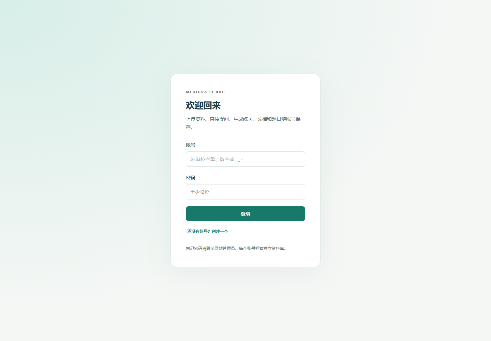
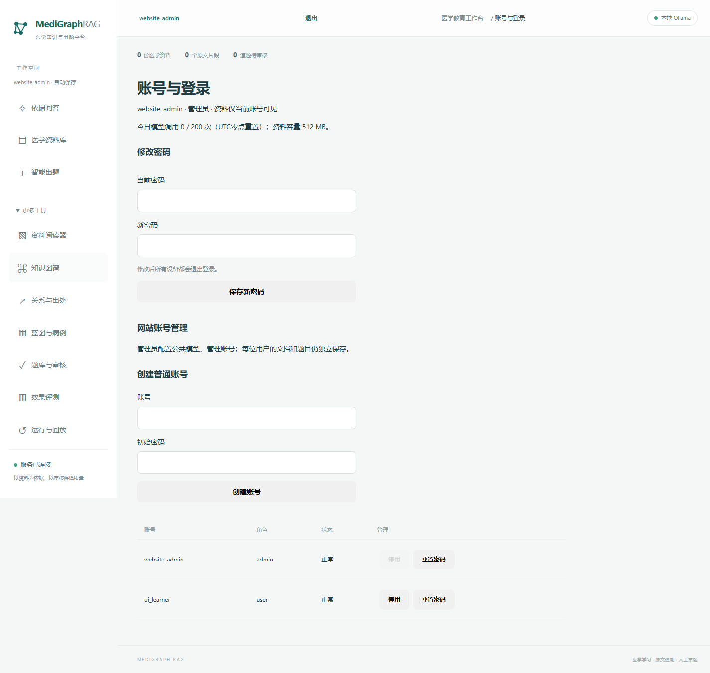
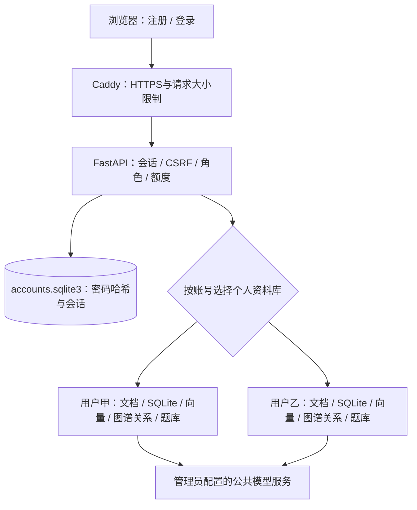

# 账号与服务器部署

本轮工作分支：`feature/accounts-and-deployment`，基于 main 0.7.0。
当前尚未租用服务器，域名、服务器 IP、模型接口及密钥均留白。此文提供可填写的部署模板，不代表已经上线。

## 用户如何使用

打开网站 → 注册或登录 → 直接提问，或上传文件说明要求。
普通用户不需要填写模型地址或选择检索方式。文档、题目、练习记录和任务绑定账号，换设备登录可继续使用。
管理员通过“账号与登录”创建、停用账号或重置密码，通过“模型与设置”统一配置服务。
管理员账号不会自动看到其他人的资料库。具有服务器文件权限的运维人员仍可访问磁盘数据，此版本不提供端到端加密。





以上为临时测试账号的真实界面截图，不含真实用户资料。登录页仅账号和密码两个字段，首次注册直接进入工作台。
忘记密码由管理员重置；暂不提供邮箱验证码或邮件找回。



## 先在本机体验

在项目根目录运行，保留现有 Python 3.10 环境：

```powershell
& '..\.venv\Scripts\python.exe' main.py --accounts --port 8001
```

打开 `http://127.0.0.1:8001/`，自行创建账号。没有预设用户名或密码，也不会把第一个注册者自动设为管理员。
此参数只允许本机地址，并仅为本地 HTTP 关闭 Secure Cookie；公网部署必须使用下面的配置。
需要本机管理员时，在另一个终端运行并交互输入密码：

```powershell
& '..\.venv\Scripts\python.exe' main.py create-admin your_admin_name
```

如果设置过 `MEDIGRAPH_DATA_DIR`，两个终端需指向同一目录。重置密码用 `main.py reset-password 账号名`。
密码不会作为命令参数或日志输出；自动化可使用 `--password-stdin` 从标准输入传入。

默认直接运行 `main.py` 仍是原来的本机免登录模式。原浏览器匿名资料库保留，不会自动归入新账号；可通过原入口导出或重新上传。
两种模式不要当作同一身份使用，公开站点始终必须启用账号模式。

## 租好服务器以后填写

模板位于 `deploy/server.env.example`。本地已准备忽略上传的 `deploy/server.env`，实际部署时复制模板到服务器再填写。

| 配置 | 何时填写 / 用途 |
|---|---|
| `DOMAIN` | 指向服务器的域名，不带 `https://` 或路径；不填时 Compose 拒绝启动 |
| `SERVER_IP` | 仅备忘，不参与自动部署，不填也不会连接任何服务器 |
| `MEDIGRAPH_DEFAULT_API_BASE` | 容器能访问的 OpenAI 兼容接口，例如私网 GPU 主机上的 `/v1` |
| `MEDIGRAPH_DEFAULT_API_MODEL` | 该推理服务实际提供的模型名 |
| `MEDIGRAPH_CLOUD_API_KEY` | 服务需要鉴权时填写；私有免密服务可空置 |
| `MEDIGRAPH_VISION_API_KEY` / `MEDIGRAPH_REVIEW_API_KEY` | 独立视觉 / 审题服务需要时填写；具体接口由管理员在设置中配置 |
| `MEDIGRAPH_ALLOW_REGISTRATION` | `true` 自助注册，`false` 仅管理员创建账号 |

不要把当前 Windows 的 `127.0.0.1:8081` 填到远程容器：它指向容器自己。
网站后端与 GPU 推理可以分开部署。llama.cpp、LM Studio、Ollama 等推理端口应只在受控私网访问，浏览器只访问网站。
默认模型地址为空时可启动和管理账号、导入原生文本，模型生成要先配置接口。

## 单机 Linux 部署步骤

以下命令需等服务器准备好再执行，当前尚未执行远程操作。
在已安装 Docker Engine 与 Compose 插件的服务器上检出本分支，进入项目根目录：

```bash
cp deploy/server.env.example deploy/server.env
# 编辑 deploy/server.env，填写 DOMAIN 与模型配置；不要提交该文件。
chmod 600 deploy/server.env
docker compose --env-file deploy/server.env config --quiet
docker compose --env-file deploy/server.env build app
# 首次启动前创建管理员，按提示输入密码；不会创建默认账号。
docker compose --env-file deploy/server.env run --rm app python main.py create-admin your_admin_name
docker compose --env-file deploy/server.env up -d
docker compose --env-file deploy/server.env ps
```

域名 DNS 指向服务器，入站放行 80/443，Caddy 自动申请并续期 HTTPS 证书。
模板不把后端 8000 或模型端口映射到公网。应用以非 root 用户运行，只有一个进程，数据写入持久卷。
详见 [Caddy 自动 HTTPS](https://caddyserver.com/docs/automatic-https)。

镜像默认包含 CPU OCR、PyTorch 和 FAISS 等检索依赖，但不包含数 GB 模型权重。
将 BGE-M3 和 bge-reranker-v2-m3 目录复制到容器持久卷的 `/app/.runtime/models/` 后，管理员开启向量检索和重排。
也可以修改 `compose.yaml` 的 `INSTALL_RETRIEVAL` 为 `false` 构建轻量版，使用关键词检索；它不等价于真实向量检索。
CUDA 推理服务独立运行，此应用镜像不负责启动 Qwen3-VL，也不自动下载推理权重。

## 默认限制与实际边界

| 项目 | 默认值 / 行为 |
|---|---|
| 密码 | 12–128 字符，Argon2id 哈希；明文不落盘 |
| 会话 | 7 天；HttpOnly、SameSite=Strict，公网 Secure；数据库仅存会话令牌 SHA256 |
| 修改或重置密码 / 停用账号 | 已有会话全部失效；停用不会删除该账号的文件 |
| 请求防护 | 修改操作检查 CSRF；有 Origin 时必须与配置的网站来源一致 |
| 登录限流 | 每账号 15 分钟 10 次尝试，每 IP 15 分钟 100 次；成功尝试也计数 |
| 注册限流 | 每 IP 每小时 10 次尝试 |
| 普通请求 | 每账号每分钟 300 次，页面轮询也计数 |
| 模型调用 | 每账号每天 200 次实际调用尝试，生成、视觉、审题均计数；UTC 零点重置；失败调用也计数 |
| 上传请求 | 单次请求体 50 MB，仍受原有单文件 25 MB 等解析上限约束 |
| 资料容量 | 每账号 512 MB；导入前按现有文件与请求大小估算检查，原件暂存按双份预留 |
| 上传处理任务 | 每账号最多 3 个未完成工作台任务；不等于全站并发性能承诺 |

额度可在 `server.env` 调整；账号页显示模型调用次数。会话和计数持久化，重启不会清零。
容量检查是导入入口的预算保护，数据库、索引等后台增长并非硬磁盘配额；系统级磁盘和全站推理并发仍应另做监控。
`MEDIGRAPH_TRUST_GATEWAY=true` 仅配合模板内唯一入口 Caddy 使用，不能同时开放后端端口或绕过网关。

此版为单机、小规模试用架构。尚未做公网并发压测、多实例部署或专业安全审计；不宣称支持任意人数同时推理。
独立任务进程、全站推理队列、共享数据库和对象存储属于后续扩容工作。
关闭注册或停用账号后，不会强行终止已经执行到一半的本地解析；之后的模型调用会检查账号状态。

## 备份与恢复

备份整个 `app_data` 卷，包含账号库、个人资料库、上传原件、索引、题库和模型配置。
为避免 SQLite 与文件不一致，先停止 `app`，按实际 Compose 项目名称备份该卷，再启动；不要使用会删除卷的 `down -v`。
`server.env` 与 Caddy 卷另行保管。恢复时保持卷内容和相同运行用户的权限，先验证登录、原文件下载、题库和索引状态再开放访问。
备份同样包含资料和凭据配置，应限制访问；本轮尚未在实际服务器执行备份恢复演练。

## 验证记录

- 本机 Python 3.10 环境：完整后端回归、前端类型检查与构建。
- 账号接口覆盖隔离、跨设备、越权、CSRF、会话注销、改密 / 重置 / 停用、限流、模型调用预算。
- 浏览器独立验收脚本：`scripts/check_accounts_ui.py`；只使用临时账号与数据，不调用模型。
- Compose 配置使用无效占位域名做结构校验，没有访问该域名，也没有申请证书。
- 本机 Docker Linux 引擎未启动，尚未实际构建镜像；公网 HTTPS、模型联网、服务器资源与负载待租机后验收。
